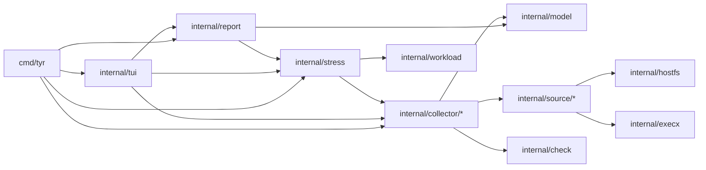

# Tyr - Developer Guide

This document is the engineering counterpart to `README.md`. It targets
contributors who build, run, test and extend Tyr.

---

## 1. Prerequisites

| Requirement | Notes |
|---|---|
| Go | 1.26 or newer (`go.mod`) |
| Linux | amd64 or arm64 to run against real hardware; tests run anywhere Go does |
| root | only for live runs that need serials, SMART, the kernel log or the BMC |
| Optional | `node` 20+ and [archify](https://github.com/tt-a1i/archify) to re-render the diagrams; `python3` for the SVG export |

---

## 2. Build & Run

```bash
CGO_ENABLED=0 go build -o tyr ./cmd/tyr     # static binary in the repo root
./tyr                                        # TUI on this machine (sudo for full data)
./tyr --fixtures testdata/fixtures/server-degraded
```

| Make target | Does |
|---|---|
| `make build` | `dist/tyr`, stripped, version-stamped |
| `make install` / `make uninstall` | static binary to / from `/usr/local/bin` |
| `make cross` | `dist/tyr-linux-{amd64,arm64}` and `dist/SHA256SUMS` |
| `make demo FIXTURE=server-healthy` | TUI against a fixture |
| `make test`, `make test-short` | unit tests |
| `make lint` | gofmt, go vet, staticcheck |
| `make live` | collectors against this host, read-only |
| `make fixtures` | regenerate the synthetic server fixtures |
| `make golden` | regenerate the workload golden table (only after changing a kernel) |
| `make diagrams` | re-render the archify diagrams and export their SVGs |

`CGO_ENABLED=0` is exported by the Makefile; a plain `go build` links against
the build host's C library because the `net` package then uses cgo.

---

## 3. Layout



| Package | Role |
|---|---|
| `cmd/tyr` | flags and subcommands (stdlib `flag`) |
| `internal/collector` | the collector interface, the shared environment, parallel collection |
| `internal/collector/{system,cpu,memory,storage,power,network,accel,events}` | one module each; fill a section and its findings |
| `internal/source/*` | readers and parsers: sysfs, dmidecode, SMART, IPMI, Redfish, RAID, PCI, GPU tools, kernel log, netinfo |
| `internal/check` | thresholds and status evaluation |
| `internal/explain` | the alert catalog: meaning, causes and commands for every finding code (a test keeps it in step with the collectors) |
| `internal/affinity`, `internal/cpuset` | CPU pinning and CPU list parsing for the core tests |
| `internal/model` | `Snapshot` and the shared types; the JSON schema |
| `internal/stress` | test lifecycle, guard rules, engines, install planner, metric series, the isolated offline-core test |
| `internal/workload` | deterministic compute kernels checked against golden values |
| `internal/report` | Markdown reports, Mermaid charts, history, glamour rendering |
| `internal/tui` | the Bubble Tea front end |
| `internal/hostfs`, `internal/execx` | read-only host access; tool execution without a shell, with deadlines |
| `internal/fixture` | replays a recorded host for tests and `--fixtures` |

More: [docs/architecture.md](docs/architecture.md).

---

## 4. Rules

1. **Read-only.** Collectors never write to the host. External tools run through
   `execx` (no shell, context deadline); IPMI runs an allowlist of read-only
   commands. Tyr never changes the boot configuration.
2. **Local first.** sysfs, hwmon, procfs and `/dev/kmsg` before tools; the BMC
   only where Linux has no answer.
3. **Nothing silent.** A source that cannot be used is recorded with its reason
   (`SetSource`), and the TUI and reports show it.
4. **Status without colour.** Every status has a glyph and a word
   (`● OK ▲ WARN ✖ CRIT ? UNKNOWN ○ unavailable`); golden tests render dark,
   light and NO_COLOR and require the same text.
5. **No new dependencies** without a discussion first.
6. **Commit messages, comments and files describe the work only** - no notes or
   trailers crediting the tool that helped write them (see §8).

---

## 5. Tests

```bash
go test ./...                                   # everything below except live
go test ./internal/tui -run TestGoldenScreens -update   # rewrite golden screens after a UI change
```

| Kind | Where | Notes |
|---|---|---|
| Unit | every package | fixtures, no root, no network |
| Golden screens | `internal/tui/testdata/golden` | 22 screens × 80×24, 120×40, 160×50; dark, light and NO_COLOR must match |
| Workload goldens | `internal/workload` | `make golden` only after changing a kernel |
| Live collectors | `make live` | `TYR_LIVE=1`, read-only, this host |
| Live clipboard | `TYR_CLIP_LIVE=1 go test ./internal/tui -run TestCopyLiveDesktop` | copies through `xclip`/`wl-copy` and restores the clipboard |
| Screen dumps | `TYR_SHOW=server-degraded:4,6+enter:120x40 go test ./internal/tui -run TestDumpTabs -v` | prints screens; `TYR_STRESS=server-degraded:120x40` dumps a stress run |

Tests never touch the real clipboard: `TestMain` in `internal/tui` replaces the
environment and the clipboard tool.

### Fixtures

A fixture is a recorded host: `manifest.json`, `root/{proc,sys,dev,var}` and
the output of each tool in `cmd/*.txt`; optionally a Redfish tree in
`redfish/v1/**.json` (one file per resource, `index.json` for `/redfish/v1/`).

The synthetic fixtures come from `tools/genfixture` (`make fixtures`); edit the
scenarios there, never the generated files. `server-degraded` carries the
faults the checks are tested against, among them an offline CPU with its
machine check history in the journal and a pstore crash record, program
crashes clustered on one core, an unclean boot, iSCSI path errors, and a
Redfish tree with event logs and a power supply without AC input.

```bash
sudo scripts/capture-fixtures.sh --redact /tmp/myhost "1U server, 2× Xeon"
tyr --fixtures /tmp/myhost
```

The script runs read-only commands only - the same ones Tyr runs, including
the journal queries for earlier boots, the boot history, `ras-mc-ctl --errors`,
pstore and `ethtool -g`/`-l`. It does not record Redfish (that needs BMC
credentials). `--redact` replaces serials, UUIDs, MAC addresses and the
hostname; review the output before committing it - kernel log lines and crash
records can name hosts and paths.

---

## 6. Diagrams

Architecture pictures are [archify](https://github.com/tt-a1i/archify)
diagrams; in-text flows, sequences and charts are Mermaid, which GitHub and
GitLab render.

| Source | Page | Image the docs embed |
|---|---|---|
| `docs/diagrams/architecture.architecture.json` | `docs/diagrams/architecture.html` | `docs/images/architecture.svg` |
| `docs/diagrams/stress-lifecycle.lifecycle.json` | `docs/diagrams/stress-lifecycle.html` | `docs/images/stress-lifecycle.svg` |
| `docs/diagrams/reports.dataflow.json` | `docs/diagrams/reports.html` | `docs/images/reports.svg` |

```bash
git clone https://github.com/tt-a1i/archify ~/src/archify
make diagrams ARCHIFY=~/src/archify
```

`make diagrams` renders each JSON, runs archify's checks, and exports a
dual-theme SVG (`scripts/export-diagram.py`) that follows the reader's light or
dark theme. Edit the JSON, never the HTML or SVG.

TUI screenshots in `docs/images/tui/` come from the golden fixture at 120×40.

---

## 7. CI

`.github/workflows/ci.yml` runs on pushes to `main` and on pull requests:

1. no tool attribution in commit messages, the pull request, or tracked files
   (`scripts/check-attribution.sh`)
2. gofmt, `go vet`, staticcheck
3. `go test ./...`
4. `make cross` (static amd64 and arm64)

---

## 8. Hooks and commit messages

```bash
git config core.hooksPath scripts/hooks
```

- `commit-msg` rejects messages with tool attribution.
- `pre-commit` rejects added lines and new file names with it, and unformatted Go.

Messages: a short subject (`area: what changed`), then why and how in plain
sentences.

---

## 9. Releasing

1. Tag `vX.Y.Z` on `main`.
2. `make cross` - the version comes from `git describe`.
3. Attach `dist/tyr-linux-amd64`, `dist/tyr-linux-arm64` and `dist/SHA256SUMS`
   to the release.
