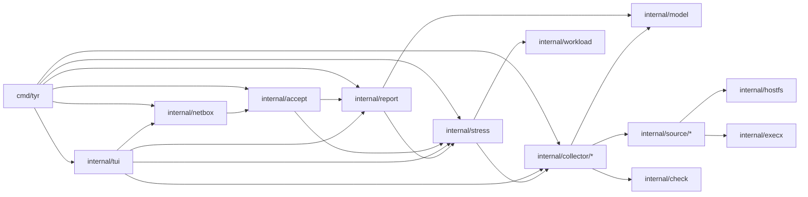

# Tyr - Developer Guide

This document is the engineering counterpart to `README.md`. It targets
contributors who build, run, test and extend Tyr.

---

## 1. Prerequisites

| Requirement | Notes |
|---|---|
| Go | 1.26 or newer (`go.mod`) |
| Linux | amd64 or arm64 to run against real hardware; tests run anywhere Go does |
| root | only for live runs that need serials, SMART, the kernel log or the BMC |
| Optional | `node` 20+ and [archify](https://github.com/tt-a1i/archify) to re-render the diagrams; `python3` for the SVG export |
| ISO | Docker to build it; `qemu-system-x86`, OVMF and mtools to boot-test it; `qemu-user-binfmt` for arm64 on an amd64 host |

---

## 2. Build & Run

```bash
CGO_ENABLED=0 go build -o tyr ./cmd/tyr     # static binary in the repo root
./tyr                                        # TUI on this machine (sudo for full data)
./tyr --fixtures testdata/fixtures/server-degraded
```

| Make target | Does |
|---|---|
| `make build` | `dist/tyr`, stripped, version-stamped |
| `make install` / `make uninstall` | static binary to / from `/usr/local/bin` |
| `make cross` | `dist/tyr-linux-{amd64,arm64}` and `dist/SHA256SUMS` |
| `make demo FIXTURE=server-healthy` | TUI against a fixture |
| `make test`, `make test-short` | unit tests |
| `make lint` | gofmt, go vet, staticcheck |
| `make live` | collectors against this host, read-only |
| `make fixtures` | regenerate the synthetic server fixtures |
| `make golden` | regenerate the workload golden table (only after changing a kernel) |
| `make ll-table` | regenerate the torture test's residues (only after changing its cases; about a minute) |
| `make diagrams` | re-render the archify diagrams and export their SVGs |
| `make release-notes`, `make release-snapshot`, `make publish`, `make publish-retry`, `make release-notes-update` | releases: see [Releasing](#9-releasing) |

`CGO_ENABLED=0` is exported by the Makefile; a plain `go build` links against
the build host's C library because the `net` package then uses cgo.

---

## 3. Layout



| Package | Role |
|---|---|
| `cmd/tyr` | flags and subcommands (stdlib `flag`) |
| `internal/collector` | the collector interface, the shared environment, parallel collection |
| `internal/collector/{system,cpu,memory,storage,power,network,accel,events}` | one module each; fill a section and its findings |
| `internal/source/*` | readers and parsers: sysfs, SMBIOS (table and dmidecode), SMART, IPMI (`/dev/ipmi0` and tools), Redfish, RAID, PCI, GPU tools, kernel log, netinfo (ethtool requests) |
| `internal/check` | thresholds and status evaluation |
| `internal/explain` | the alert catalog: meaning, causes and commands for every finding code (a test keeps it in step with the collectors) |
| `internal/affinity`, `internal/cpuset` | CPU pinning and CPU list parsing for the core tests |
| `internal/model` | `Snapshot` and the shared types; the JSON schema |
| `internal/stress` | test lifecycle, guard rules, engines, install planner, metric series, the isolated offline-core test |
| `internal/accept` | the acceptance test: built-in profiles, limits files, the verdict from snapshots and stress results, its Markdown report |
| `internal/acceptui` | the live view of `tyr accept` on a terminal: a Bubble Tea model fed by the running test (`Program.Send`): finished steps printed above, the running one with spinner, progress bar, live values, grown counters and log lines |
| `internal/notify` | webhooks: `webhooks.json` plus `TYR_WEBHOOK_*`, the events, the body per format (JSON, Slack, Teams Adaptive Card, Discord, Google Chat), delivery with retry and HMAC signature |
| `internal/isobuild` | the TUI's ISO dialog: finds the source tree, runs `iso/build.sh` with the settings in `TYR_ISO_CONFIG` (as the user behind sudo), lists USB disks (never the system disk), writes a stick and verifies it |
| `internal/settings` | where configuration files are read from and saved to: `/etc/tyr` for root, `~/.config/tyr` for a user |
| `internal/netbox` | NetBox: `netbox.json` / `tags.json`, the rule language (`expr.go`: lexer, parser, evaluator), facts from a snapshot, the REST client (dry run), the sync and the journal entry |
| `internal/workload` | deterministic compute kernels checked against golden values; the torture test's Lucas-Lehmer FFT (Go, plus AVX-512 / AVX2 FMA assembly in `fft_amd64.s`) checked against exact residues |
| `internal/report` | Markdown reports, Mermaid charts, history, glamour rendering |
| `internal/tui` | the Bubble Tea front end |
| `internal/source/crypt` | dm-crypt mappings and the block device stack from sysfs, LUKS1/2 headers (cipher, key size), TCG Level 0 discovery (sed-opal ioctl, NVMe Security Receive) |
| `internal/fsck` | filesystem check and repair: targets from udev and mountinfo, the ext superblock, plans with their blockers (processes, submounts, swap, loop, Longhorn), runs with streamed output and a log; tested against stand-in tools on `PATH` |
| `internal/fsbrowse` | the file browser: one directory's entries (lstat), subtree totals counted in the background on one filesystem, fscrypt per directory |
| `internal/hostfs`, `internal/execx` | read-only host access; tool execution without a shell, with deadlines |
| `internal/fixture` | replays a recorded host for tests and `--fixtures` |

More: [docs/architecture.md](docs/architecture.md).

### The ISO

`iso/` builds the live system that runs `tyr accept` (user side:
[docs/acceptance.md](docs/acceptance.md)).

| File | Role |
|---|---|
| `iso/build.sh` | host side: builds Tyr for the architecture, the build image (`iso/Dockerfile`), runs the builder privileged |
| `iso/builder.sh` | in the container: mmdebstrap root filesystem (package list), vendor packages, squashfs, EFI image with the signed shim and GRUB, BIOS El Torito image (amd64), xorriso |
| `iso/grub.cfg` | the boot menu for BIOS and UEFI; the profile goes on the kernel command line |
| `iso/overlay/` | copied into the image: `tyr-live` (the console program on tty1), its services, network and module settings, `tyr-live-setup` (runs once at build time) |
| `iso/vendor/` | drop-in for vendor `.deb` / `.rpm` packages; ignored by git |

Rule for the image: nothing may write to the server's disks. No automounting,
no mdadm or LVM, smartd masked; the only partition mounted read-write is the
one labelled `TYR-RESULTS` (the image's own partition 3 on a stick written
with dd, or a second stick).

Test a build in QEMU with a results stick (UEFI; drop the two `pflash`
drives for BIOS; `mcopy`/`mdir` are in mtools):

```bash
cp /usr/share/OVMF/OVMF_VARS_4M.fd /tmp/vars.fd
truncate -s 64M /tmp/stick.img && mkfs.vfat -n TYR-RESULTS /tmp/stick.img
echo '{"durations":{"cpu":"1m","memory":"1m","storage":"1m"}}' > /tmp/accept.json
mcopy -i /tmp/stick.img /tmp/accept.json ::/accept.json
truncate -s 2G /tmp/disk.img
qemu-system-x86_64 -enable-kvm -machine q35 -m 4096 -smp 4 \
  -drive if=pflash,format=raw,readonly=on,file=/usr/share/OVMF/OVMF_CODE_4M.fd -drive if=pflash,format=raw,file=/tmp/vars.fd \
  -cdrom dist/tyr-live-*-amd64.iso -drive file=/tmp/disk.img,format=raw,if=none,id=d0 \
  -device ahci,id=ahci -device ide-hd,drive=d0,bus=ahci.0 \
  -drive file=/tmp/stick.img,format=raw,if=none,id=s -device qemu-xhci -device usb-storage,drive=s
mdir -i /tmp/stick.img ::/tyr     # the results after the run
```

---

## 4. Rules

1. **Read-only.** Collectors never write to the host. External tools run through
   `execx` (no shell, context deadline); IPMI runs an allowlist of read-only
   commands. Tyr never changes the boot configuration.
2. **Local first.** sysfs, hwmon, procfs and `/dev/kmsg` before tools; the BMC
   only where Linux has no answer.
3. **Nothing silent.** A source that cannot be used is recorded with its reason
   (`SetSource`), and the TUI and reports show it.
4. **Status without colour.** Every status has a glyph and a word
   (`● OK ▲ WARN ✖ CRIT ? UNKNOWN ○ unavailable`); golden tests render dark,
   light and NO_COLOR and require the same text.
5. **No new dependencies** without a discussion first. No cgo; assembly only
   where it pays (the torture FFT), always with a Go fallback and a test
   that every path gives the same results.
6. **Commit messages, comments and files describe the work only** - no notes or
   trailers crediting the tool that helped write them (see §8).
7. **License.** Tyr is MPL-2.0 ([LICENSE](LICENSE)). New source files start
   with the header in [COPYRIGHT_HEADER.txt](COPYRIGHT_HEADER.txt); existing
   files have none yet. A new Go module dependency is listed in
   [NOTICE](NOTICE) with its licence, which must be compatible with the MPL
   (MIT, BSD, Apache-2.0, MPL-2.0).

---

## 5. Tests

```bash
go test ./...                                   # everything below except live
go test ./internal/tui -run TestGoldenScreens -update   # rewrite golden screens after a UI change
```

| Kind | Where | Notes |
|---|---|---|
| Unit | every package | fixtures, no root, no network |
| Golden screens | `internal/tui/testdata/golden` | 22 screens × 80×24, 120×40, 160×50; dark, light and NO_COLOR must match |
| Workload goldens | `internal/workload` | `make golden` only after changing a kernel; `make ll-table` only after changing the torture cases |
| FFT paths | `TestKernelsExact` | the Go, AVX2 and AVX-512 butterflies must all give the exact residues; `go test ./internal/workload -bench LL` measures them |
| Accept screen | `internal/acceptui` | the model fed with a message sequence: header, progress and times, values, counters (traffic counters left out), log lines, q/y stop, fits 80 columns; ASCII marks for `TERM=linux`. By hand in a pseudo terminal: `script -qec "tyr accept --fixtures testdata/fixtures/server-degraded --limits short.json --yes --out /tmp/acc" /dev/null` |
| Acceptance | `internal/accept` | profiles, limits files (merging, unknown fields rejected), the verdict rules, the report; a whole run without hardware: `tyr accept --fixtures testdata/fixtures/server-degraded --limits short.json --yes --out /tmp/acc` with `{"durations":{"cpu":"3s","memory":"3s","storage":"3s"}}` in `short.json` |
| ISO dialog | `internal/isobuild`, `internal/tui/isodialog_test.go` | USB disks from a fake sysfs (a stick, a USB system disk, a SATA disk), writing to a file and reading it back, cancel, settings permissions, build phases; the dialog with fake disks: system disk refused, root required, y/n, the run view |
| Webhooks | `internal/notify` | the settings (environment, unknown fields), every format's body, retry on 5xx but not 4xx, token, headers and signature against a local receiver; the TUI dialog in `internal/tui/webhooks_test.go`. By hand: `TYR_WEBHOOK_URL=http://127.0.0.1:8080 tyr accept --fixtures testdata/fixtures/server-degraded --limits short.json --yes --out /tmp/acc` with any HTTP receiver |
| Network storage | `internal/collector/storage` (`remote_test.go`) | sessions from sysfs (also NVMe/TCP), the timeline with decoded errors, iscsid's logins and retries folded, gone sessions, the findings; Longhorn on `k8s-longhorn`: volumes, data paths through md, replicas, node checks, multipath blacklists, kubelet / logrus / JSON log lines and the 24 h window; the TUI view in `internal/tui/storage_remote_test.go` |
| Encryption | `internal/source/crypt`, `internal/collector/storage` (`crypt_test.go`) | dm uuids, LUKS1/2 headers, TCG discovery responses (Opal, Pyrite); a small sysfs tree built in the test: LUKS over md, an EFI partition left out, a closed LUKS partition, an unencrypted disk with a swap file, the findings only when required, ext4 error counters. The fixtures have no `/sys/class/block`, so they show no encryption |
| SMART | `internal/source/smart` | smartctl JSON for ATA (also the Device Statistics log and vendor attribute fallbacks, as on an HPE SATA SSD), SAS (data processed, start-stop cycles), NVMe, nvme-cli and the raw health log |
| Filesystem check | `internal/fsck`, `internal/tui/fsckdialog_test.go` | plans (unmounted, mounted with bind mounts, busy, submounts, swap file, root, Longhorn in use / in maintenance mode, live ISO, btrfs and xfs online), the tools' exit codes, the ext superblock, targets from udev and mountinfo; whole runs against stand-in `umount` / `mount` / `e2fsck` scripts on `PATH` (order, remount, a failed repair stays unmounted, a busy unmount). The dialog: typed confirmation, a repair neither esc nor ctrl+c stops, a check that does. By hand, only on a spare disk: `sudo tyr fsck /dev/sdX1` |
| File browser | `internal/fsbrowse`, `internal/tui/filebrowser_test.go` | totals on a temporary tree (hard links once, sparse files by allocated size), sorting, forgetting; the view at 80×24 and 160×50, navigation, filter, the progress and end-of-count messages |
| NetBox | `internal/netbox` | the rule language, facts from the fixtures, the files; the sync against an in-memory fake NetBox (`sync_test.go`: new device, second run writes only the journal, failed → active, tag rules next to foreign tags, dry run, wrong token, NetBox before 4.2); the TUI dialog in `internal/tui/netbox_test.go` |
| GPU tools | `internal/source/gpu/testdata` | `nvidia-smi -q -x` of a DGX Spark (GB10: C2C, no own memory, T.Limit, processes) |
| Live collectors | `make live` | `TYR_LIVE=1`, read-only, this host |
| Live clipboard | `TYR_CLIP_LIVE=1 go test ./internal/tui -run TestCopyLiveDesktop` | copies through `xclip`/`wl-copy` and restores the clipboard |
| Screen dumps | `TYR_SHOW=server-degraded:4,6+enter:120x40 go test ./internal/tui -run TestDumpTabs -v` | prints screens; `TYR_STRESS=server-degraded:120x40` dumps a stress run; `TYR_SHOW_ANSI=DIR` also writes them with colours; `TYR_SHOW_MD=1 go test ./internal/report -v` prints the generated report and history Markdown; `TYR_DUMP=1` prints the CPU collector's parsed data |

Tests never touch the real clipboard: `TestMain` in `internal/tui` replaces the
environment and the clipboard tool.

### Fixtures

A fixture is a recorded host: `manifest.json`, `root/{proc,sys,dev,var}` and
the output of each tool in `cmd/*.txt`; optionally a Redfish tree in
`redfish/v1/**.json` (one file per resource, `index.json` for `/redfish/v1/`).

The synthetic fixtures come from `tools/genfixture` (`make fixtures`); edit the
scenarios there, never the generated files. `server-degraded` carries the
faults the checks are tested against, among them an offline CPU with its
machine check history in the journal and a pstore crash record, program
crashes clustered on one core, an unclean boot, an iSCSI session that timed
out over a degraded bond, and a Redfish tree with event logs and a power supply
without AC input. `k8s-longhorn` is `server-healthy` as a k3s node with Longhorn:
a flapping volume session, a volume whose filesystem went read-only after a
recovery timeout, an orphaned session, multipathd without a blacklist, a failed
replica, the kubelet failing to mount a volume, and the pods' logs.

Not everything is generated yet: the VPN interfaces, `/etc/os-release`, the
iSCSI details of `server-degraded` and the whole `k8s-longhorn` fixture were
added to the generated trees afterwards (`tools/fixture-iscsi.py` for the
iSCSI and Longhorn parts). `make fixtures` drops them; after it, restore them
with `git checkout` or run the script again.

```bash
sudo scripts/capture-fixtures.sh --redact /tmp/myhost "1U server, 2× Xeon"
tyr --fixtures /tmp/myhost
```

The script runs read-only commands only - the same ones Tyr runs, including
the journal queries for earlier boots, the boot history, `ras-mc-ctl --errors`,
pstore and `ethtool -g`/`-l`. It does not record Redfish (that needs BMC
credentials). `--redact` replaces serials, UUIDs, MAC addresses and the
hostname; review the output before committing it - kernel log lines and crash
records can name hosts and paths.

---

### Native readers

SMBIOS, the NICs and the BMC are read without their tools (`dmi.ParseTable`,
`netinfo.Ethtool`, `ipmi.OpenNative`); the tools stay as fallbacks. Their
unit tests build SMBIOS tables, SFP/QSFP EEPROMs and BMC answers to the specs.
On real hardware, compare them with the tools:

```bash
sudo tyr check-native          # SMBIOS vs dmidecode, NICs vs ethtool, BMC vs ipmitool
TYR_LIVE=1 go test ./internal/source/netinfo -run TestEthtoolLive -v
```

`check-native` prints every difference and exits 1 if there is one - run it
on each new kind of server and fix the reader, not the comparison.

---

## 6. Diagrams

Architecture pictures are [archify](https://github.com/tt-a1i/archify)
diagrams; in-text flows, sequences and charts are Mermaid, which GitHub and
GitLab render.

| Source | Page | Image the docs embed |
|---|---|---|
| `docs/diagrams/architecture.architecture.json` | `docs/diagrams/architecture.html` | `docs/images/architecture.svg` |
| `docs/diagrams/stress-lifecycle.lifecycle.json` | `docs/diagrams/stress-lifecycle.html` | `docs/images/stress-lifecycle.svg` |
| `docs/diagrams/reports.dataflow.json` | `docs/diagrams/reports.html` | `docs/images/reports.svg` |

```bash
git clone https://github.com/tt-a1i/archify ~/src/archify
make diagrams ARCHIFY=~/src/archify
```

`make diagrams` renders each JSON, runs archify's checks, and exports a
dual-theme SVG (`scripts/export-diagram.py`) that follows the reader's light or
dark theme. Edit the JSON, never the HTML or SVG.

TUI screenshots in `docs/images/tui/` come from the golden fixture at 120×40.

---

## 7. CI

`.github/workflows/ci.yml` runs on pushes to `main` and on pull requests:

1. no tool attribution in commit messages, the pull request, or tracked files
   (`scripts/check-attribution.sh`)
2. gofmt, `go vet`, staticcheck
3. `go test ./...`
4. `make cross` (static amd64 and arm64)

---

## 8. Hooks and commit messages

```bash
git config core.hooksPath scripts/hooks
```

- `commit-msg` rejects messages with tool attribution.
- `pre-commit` rejects added lines and new file names with it, and unformatted Go.

Messages: a short subject (`area: what changed`), then why and how in plain
sentences.

---

## 9. Releasing

Versions follow [semantic versioning](https://semver.org), starting at
v1.0.0: **major** for incompatible changes to the command line, the JSON
snapshot schema or the configuration files, **minor** for new features,
**patch** for fixes. Commit messages don't encode the kind of change, so you
choose the next version.

A release is the tag `vX.Y.Z` and a GitHub release with
`tyr_X.Y.Z_linux_amd64.tar.gz`, `tyr_X.Y.Z_linux_arm64.tar.gz` (the static
binary, README, CHANGELOG, docs) and `SHA256SUMS`. Its notes are the
highlights written by hand in `CHANGELOG.md` plus the commits since the last
release, grouped by their area (`storage: …` → Storage, `tui: …` → TUI;
`tools/relnotes` holds the mapping).

1. Write the highlights - what changed for users, upgrade notes - under
   `## Unreleased` in `CHANGELOG.md`, and commit them.
2. Preview: `make release-notes BUMP=minor`.
3. Build the archives without publishing (optional): `make release-snapshot`
   → `dist/release/`.
4. Publish:

   ```bash
   export GITHUB_TOKEN=…        # fine-grained token: Contents read/write on noahzmr/tyr
   make publish BUMP=minor      # or BUMP=patch|major, or RELEASE=v1.4.0
   ```

   `make publish` stops at the first problem, before anything is pushed: not
   on `main`, uncommitted or untracked files, behind `origin/main`, the tag
   exists, no highlights, gofmt / vet / staticcheck / the attribution check /
   the tests fail, the archives do not build. Then it moves the highlights
   into a `## [X.Y.Z] - date` section with the generated list, shows the
   notes and asks you to type the version; only then it commits
   `release: vX.Y.Z`, tags, pushes `main` and the tag together and publishes
   the release with GoReleaser. Answering anything else puts `CHANGELOG.md`
   back. `YES=1` skips the question.
5. If the upload fails after the push: fix the cause and `make publish-retry`
   (publishes the tag at `HEAD` again).
6. To change the text of a published release - a typo, a forgotten upgrade
   note - edit its section in `CHANGELOG.md` and run
   `make release-notes-update RELEASE=vX.Y.Z` (default: the latest tag). It
   only replaces the text; the archives and checksums stay as published.

`CHANGELOG.md` is wrapped for reading in an editor. The release text joins
the wrapped lines of paragraphs and list items (headings, tables and code
stay as they are), because GitHub shows a release's line breaks as written.
After the upload `make publish` sets the text once more from `CHANGELOG.md`,
so a release never stays without notes.

GoReleaser is pinned in `scripts/release.sh` and run with `go run` (it is not
in `go.mod`); the first run compiles it and Go may download the newer
toolchain it needs. Set `GORELEASER=goreleaser` to use an installed one.
Only GitHub is published to: a `GITLAB_TOKEN` in the environment is hidden
from GoReleaser.

The ISO is not part of a release. To attach one by hand: `make iso`, only
when `iso/vendor/` is empty (vendor tools may not be redistributed).
