```text
 ███████████ █████ █████ ███████████
░█░░░███░░░█░░███ ░░███ ░░███░░░░░███
░   ░███  ░  ░░███ ███   ░███    ░███
    ░███      ░░█████    ░██████████
    ░███       ░░███     ░███░░░░░███
    ░███        ░███     ░███    ░███
    █████       █████    █████   █████
   ░░░░░       ░░░░░    ░░░░░   ░░░░░
```

<div align="center">

  <h1>Tyr</h1>

  <p>
    <strong>Know your hardware. Then put it to the test.</strong>
    <br/>
    <em>Hardware inventory, health checks and stress tests for Linux servers and workstations - one static binary, one terminal.</em>
  </p>

  <p>
    <a href="#quick-start"><strong>Quick Start »</strong></a>
    &nbsp;·&nbsp;
    <a href="#features">Features</a>
    &nbsp;·&nbsp;
    <a href="#screens">Screens</a>
    &nbsp;·&nbsp;
    <a href="#further-documentation">Docs</a>
    &nbsp;·&nbsp;
    <a href="https://github.com/noahzmr/tyr/issues/new" target="_blank"><strong>Report an issue »</strong></a>
  </p>

  <p>

[](https://go.dev/)
[](https://www.kernel.org/)
[](#build-instructions)
[](#run-on-a-remote-host)
[](https://github.com/noahzmr/tyr/actions/workflows/ci.yml)

[](https://github.com/charmbracelet/bubbletea)
[](https://github.com/charmbracelet/lipgloss)
[](https://github.com/charmbracelet/glamour)
[](https://mermaid.js.org/)
[](https://github.com/tt-a1i/archify)
[](https://www.smartmontools.org/)
[](https://en.wikipedia.org/wiki/Intelligent_Platform_Management_Interface)
[](https://docs.kernel.org/driver-api/edac.html)

  </p>
</div>

Tyr reads what a machine is made of - every CPU, DIMM, disk, RAID set, port,
transceiver, GPU, PSU and fan, with vendor, part number, serial and firmware -
checks each part against its own limits, and loads CPU, memory, storage and
network while it watches temperatures, machine checks and ECC errors. Results
come as a live TUI, a text, JSON or Markdown report, and a history across any
number of saved runs. Copy the binary to a host, run it, take the report home.

- **Author**: Noah Zeumer &lt;[github.com/noahzmr](https://github.com/noahzmr)&gt;
- **Status**: active development, Linux only (amd64, arm64)

---

## What does "Tyr" mean?

Týr is the Norse god of law and courage. When the gods bound the wolf Fenrir,
Týr put his hand in the wolf's mouth as a pledge that the binding was fair.
Tyr the tool does the same for hardware: it binds a machine to a test under a
guard that keeps it safe, and gives a verdict you can trust.

---

## Table of Contents

- [Features](#features)
- [Screens](#screens)
- [Architecture](#architecture)
- [Prerequisites](#prerequisites)
- [Quick Start](#quick-start)
- [Build Instructions](#build-instructions)
- [Run on a remote host](#run-on-a-remote-host)
- [CLI Reference](#cli-reference)
- [Keys](#keys)
- [Stress tests](#stress-tests)
- [Reports and history](#reports-and-history)
- [Directory Structure](#directory-structure)
- [Development](#development)
- [Further Documentation](#further-documentation)
- [Glossary](#glossary)

---

## Features

### Hardware inventory

- Every component with vendor, model, part number, serial and firmware: system,
  chassis, board, BMC, CPUs (PPIN), DIMMs, disks, RAID controllers and drives,
  NICs (PCI VPD), transceivers, GPUs, NPUs, PSUs, FRUs.
- List view with search across all fields and category chips; topology tree with
  status rolled up into every branch and a fixed serial column.
- `c` copies the selected serial.

### Health checks

| Module | What Tyr looks at |
|---|---|
| CPU | online cores, per-core temperature and clock, throttling, machine checks, microcode, an optional per-core compute test |
| Memory | DIMMs per slot, ECC corrected / uncorrected (EDAC), poisoned pages, DIMM temperatures, memory the OS cannot see |
| Storage | SMART (ATA, SCSI, NVMe), wear, reallocated and pending sectors, I/O errors in the kernel log, md RAID, MegaRAID/PERC, filesystems |
| Network | link, speed vs. port and partner, duplex, bonds, CRC and error counters, transceiver optics, LLDP neighbours, BMC LAN |
| GPU/NPU | PCIe link width and speed, temperatures, power, ECC, retired/remapped rows, driver errors (Xid) |
| System | identity, BIOS, BMC, PSU inventory, fans and chassis temperatures |

- Local Linux interfaces first (sysfs, hwmon, procfs, `/dev/kmsg`); external
  tools only where they add data; the BMC only where Linux has no answer.
- Every reading is checked against the part's own limit (hwmon, SMART, the
  transceiver, AMD's Tjmax per CPU family), else a configurable default.
- Data sources that could not be used are listed with the reason - nothing is
  silently missing.

### Stress tests

- CPU, memory, storage and network, one at a time or as a full test.
- Built-in engines that verify every result, plus `stress-ng`, `mprime`,
  `memtester` and `iperf3` when installed; the TUI installs the packaged ones.
- Baseline snapshot → load under a safety guard → after snapshot → verdict.
- The guard lets a CPU run at its own limit and stops it 5 °C beyond; drives,
  DIMMs and GPUs stop at their critical temperature; any new machine check or
  uncorrectable ECC error stops the run.
- The memory test locks its buffer in RAM and goes up to 100 % of available
  memory.
- `S` on any tab stresses the selected component, `F` runs the full test.

### Reports and history

- Markdown reports (hardware, alerts, component and per-core health; stress
  results with Mermaid charts), text and JSON.
- History across any number of saved snapshots and results: status over time,
  alert timeline, counter and sensor trends, hardware and firmware changes,
  every stress run as a Mermaid gantt.
- View in the terminal like glow, save, or copy to the clipboard.

### One static binary

- CGO-free, no runtime dependencies: copy it to a host with `scp` and run it.
- Works without root (and says what it could not read); runs as root for
  serials, SMART and the BMC.

---

## Screens

| | |
|---|---|
| 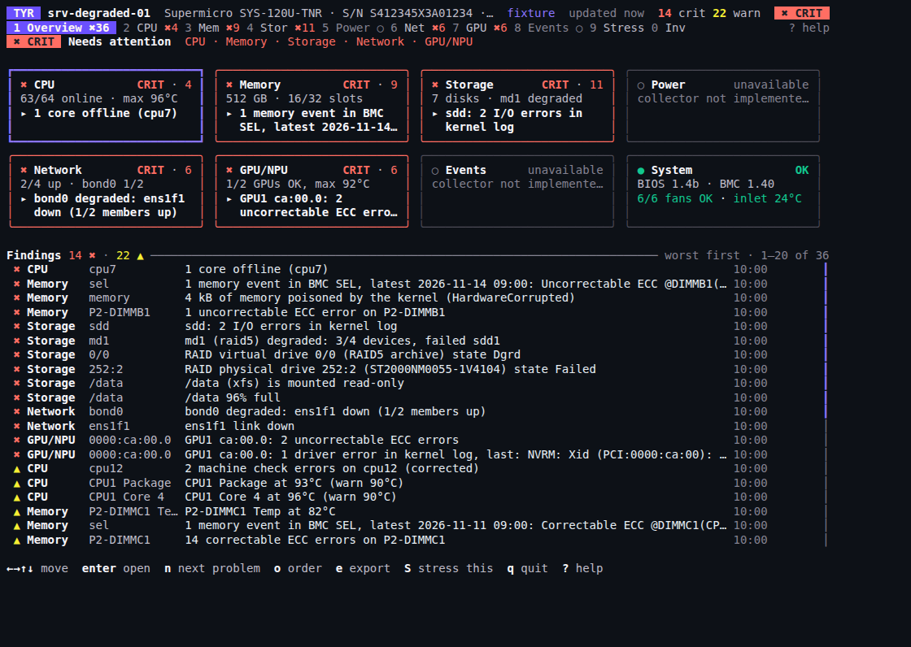 | 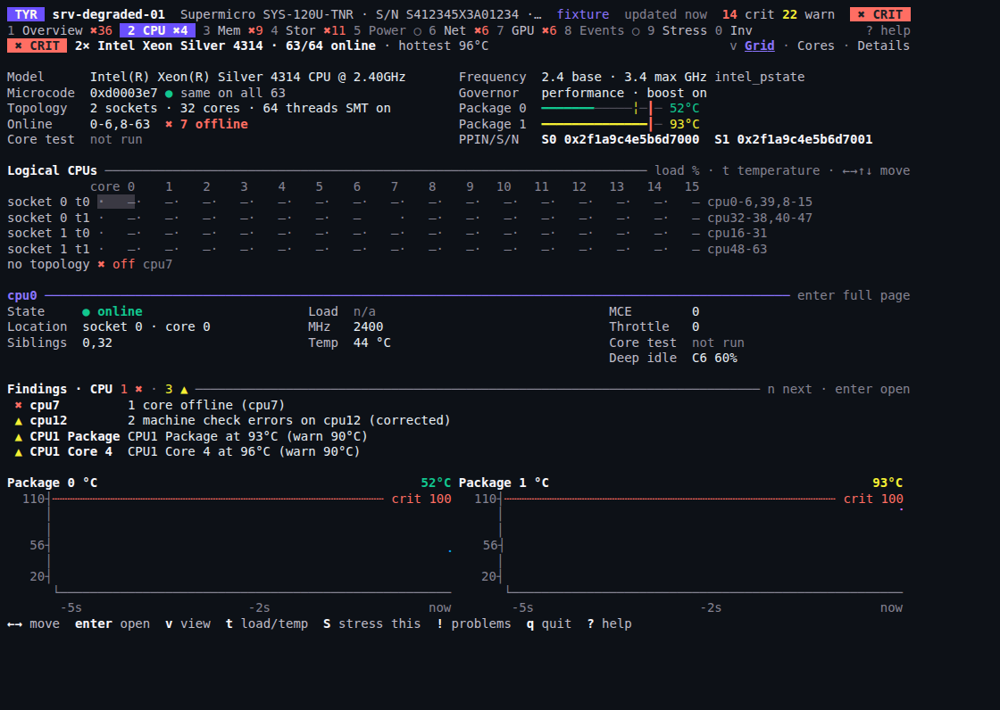 |
| **Overview**: module cards, findings worst first | **CPU**: every core by socket and thread |
| 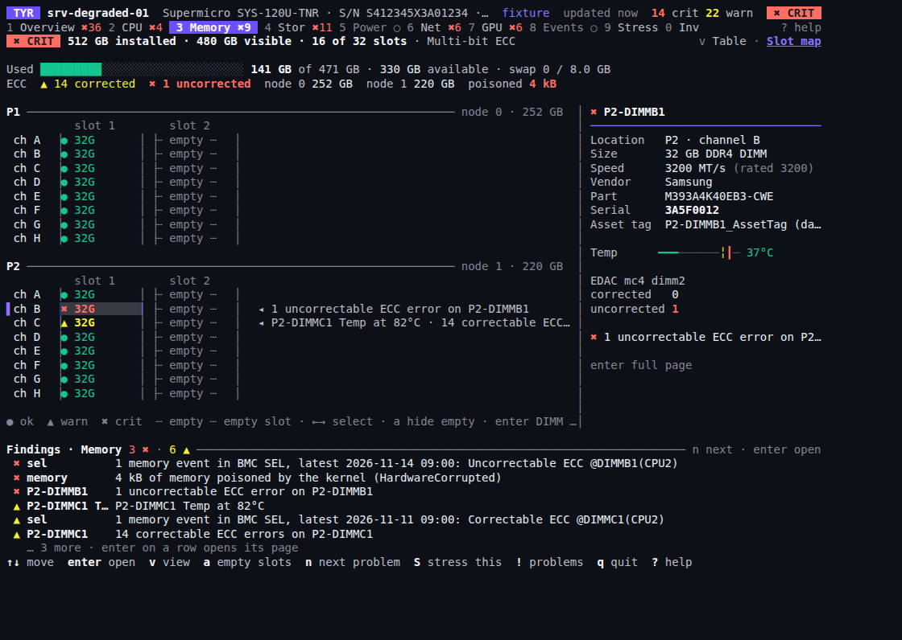 | 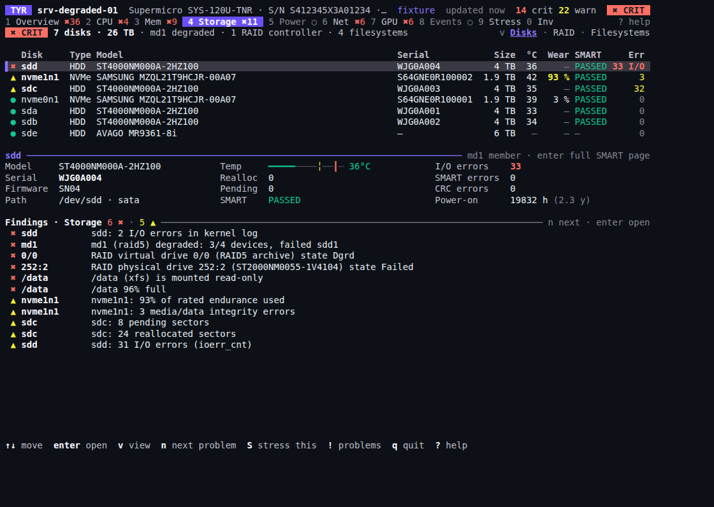 |
| **Memory**: slot map per socket and channel | **Storage**: disks with SMART, RAID, filesystems |
| 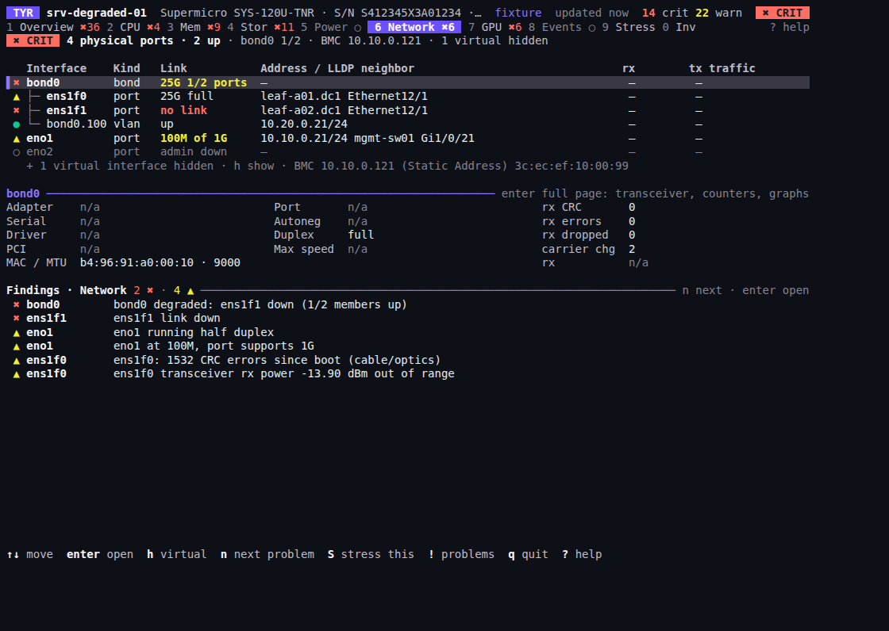 | 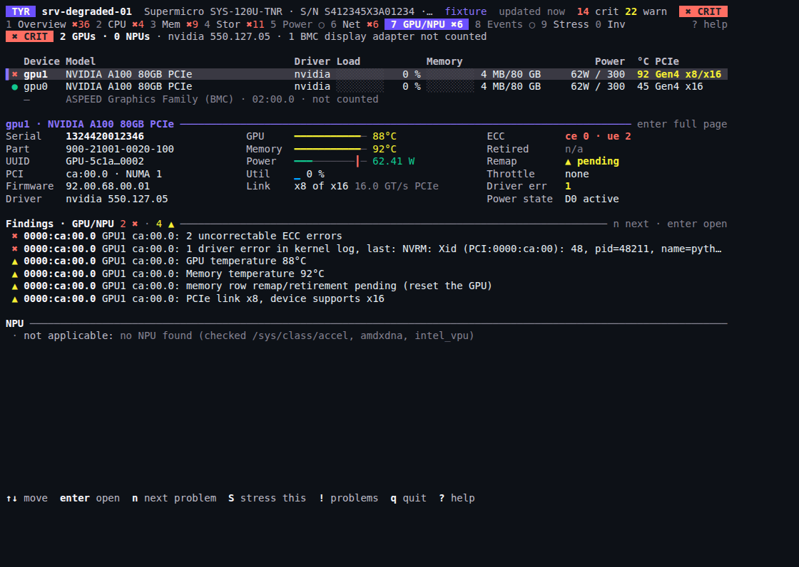 |
| **Network**: bonds, VLANs, transceivers, LLDP | **GPU/NPU**: load, memory, power, PCIe link |
| 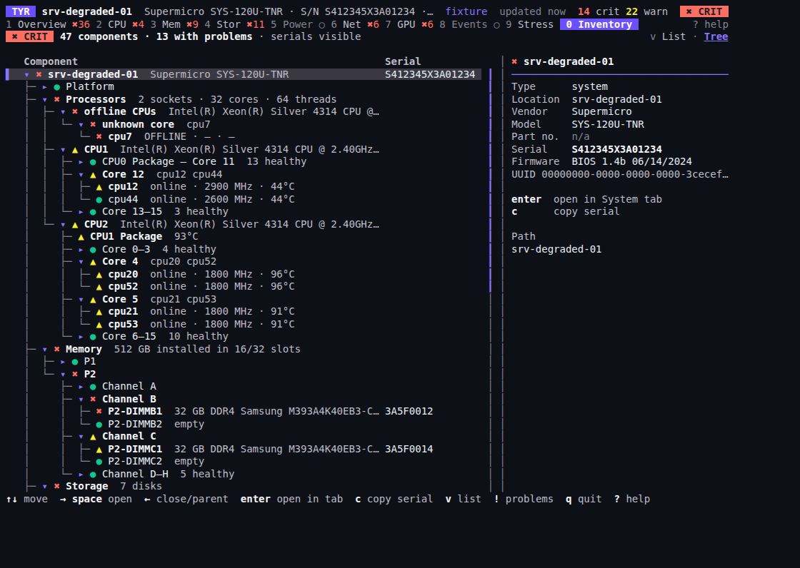 | 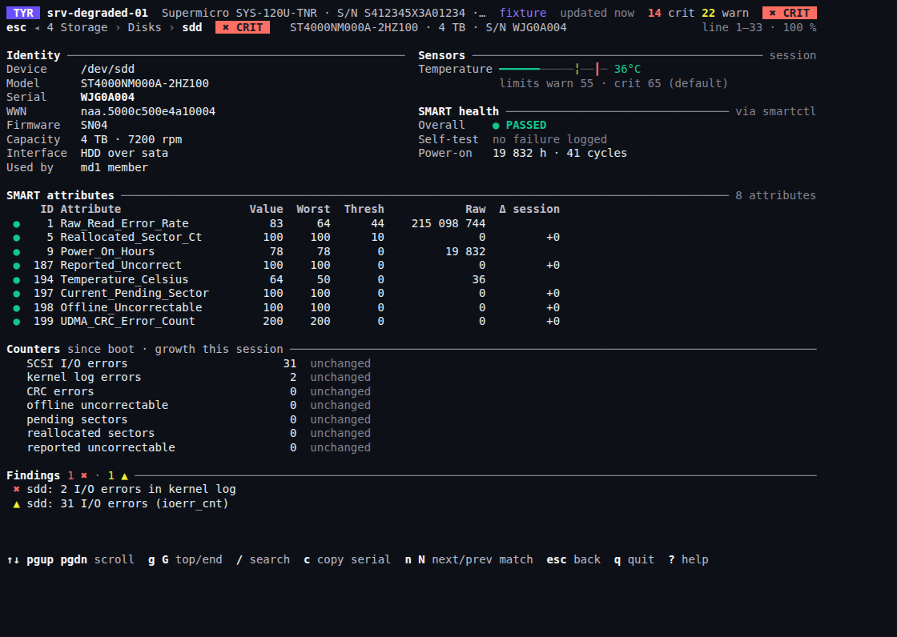 |
| **Inventory**: topology tree with serials | **Detail page**: a disk with SMART attributes |
| 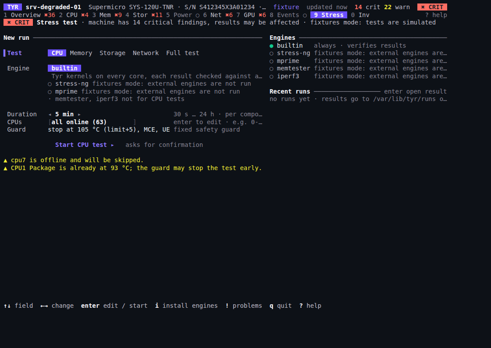 | 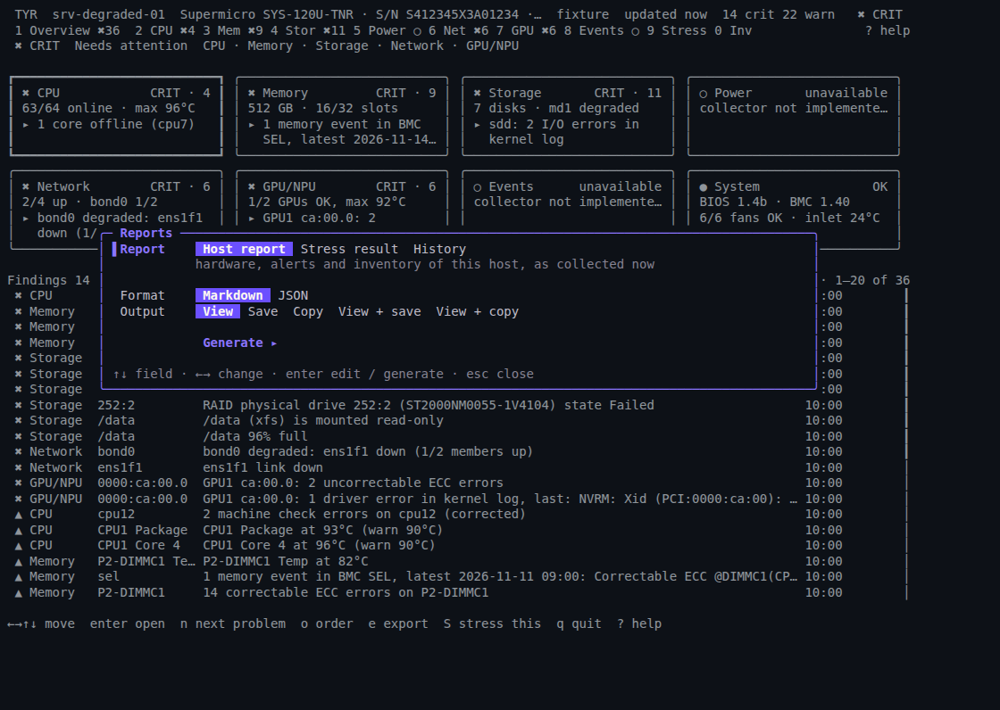 |
| **Stress**: form, engines, recent runs | **Reports**: host, stress result or history |

All screens show the `server-degraded` fixture at 120×40 (`make demo`).

---

## Architecture


Collectors read the host in parallel into one `Snapshot`; thresholds turn
readings into OK / WARN / CRIT findings. The TUI, the CLI and the stress
engine all work from that snapshot, and the report renderer turns saved JSON
into Markdown. Details: [docs/architecture.md](docs/architecture.md).

---

## Prerequisites

| Requirement | Notes |
|---|---|
| Go | 1.26 or newer, to build |
| Linux | amd64 or arm64; any distribution (the binary is static) |
| root | recommended: serials (dmidecode, PCI VPD), SMART, the kernel log, the BMC |

Optional tools Tyr uses when they are installed:

| Tool | For |
|---|---|
| `dmidecode` | DIMM slots, serials, PSU inventory (SMBIOS) |
| `smartctl`, `nvme` | SMART and NVMe health |
| `storcli` / `perccli` | MegaRAID / PERC hardware RAID |
| `ipmitool` or `ipmiutil` | BMC sensors, SEL, FRU (read-only commands only) |
| `nvidia-smi`, `xrt-smi` | NVIDIA GPUs, AMD NPUs |
| `ethtool`, `lldpctl` | transceiver data, LLDP neighbours |
| `stress-ng`, `memtester`, `iperf3`, `mprime` | extra stress engines |
| `wl-copy`, `xclip` or `xsel` | copying in terminals without OSC 52 (GNOME Terminal, Ptyxis) |

---

## Quick Start

```bash
git clone https://github.com/noahzmr/tyr.git
cd tyr
make install          # static binary to /usr/local/bin/tyr
sudo tyr              # TUI on this machine
```

Without hardware at hand, look at a recorded server:

```bash
tyr --fixtures testdata/fixtures/server-degraded
```

---

## Build Instructions

### Build

```bash
CGO_ENABLED=0 go build -o tyr ./cmd/tyr
```

`CGO_ENABLED=0` makes the binary static, so it runs on any Linux of the same
architecture. A plain `go build` works too, but links against the build host's
C library.

### Run from source

```bash
go run ./cmd/tyr
```

### Install system-wide

```bash
CGO_ENABLED=0 go build -o tyr ./cmd/tyr \
  && chmod +x tyr \
  && sudo mv tyr /usr/local/bin/
```

or `make install`, which also strips the binary and stamps the version.
Verify:

```bash
which tyr             # /usr/local/bin/tyr
tyr version
```

### Uninstall

```bash
sudo rm /usr/local/bin/tyr      # or: make uninstall
```

### Cross-compile

```bash
make cross    # dist/tyr-linux-amd64, dist/tyr-linux-arm64, dist/SHA256SUMS
```

or by hand:

```bash
CGO_ENABLED=0 GOOS=linux GOARCH=amd64 go build -o tyr-linux-amd64 ./cmd/tyr
CGO_ENABLED=0 GOOS=linux GOARCH=arm64 go build -o tyr-linux-arm64 ./cmd/tyr
```

### Tests

```bash
go test ./...     # unit tests, golden screens, fixtures
make lint         # gofmt, go vet, staticcheck
```

---

## Run on a remote host

```bash
# copy (ssh host uname -m: x86_64 = amd64, aarch64 = arm64)
scp dist/tyr-linux-amd64 dist/SHA256SUMS admin@host:/tmp/
ssh admin@host 'cd /tmp && sha256sum --ignore-missing -c SHA256SUMS && mv tyr-linux-amd64 tyr && chmod +x tyr'

ssh -t admin@host sudo /tmp/tyr                                  # TUI
ssh admin@host sudo /tmp/tyr report                              # text report
ssh admin@host sudo /tmp/tyr report --format json > host.json    # snapshot, keep for history
ssh admin@host sudo /tmp/tyr stress --component full --duration 10m --yes
```

Without a terminal on stdout `tyr` prints the text report, so `ssh host tyr`
and cron work unchanged.

| What | Where on the remote host | Fetch |
|---|---|---|
| Report | stdout | redirect |
| TUI export (`e`) | `tyr-snapshot-<host>-<time>.json` and `.md` in the working directory | `scp host:/tmp/tyr-snapshot-* .` |
| Stress results | `/var/lib/tyr/runs/*.json`, else `./tyr-runs/` | `scp 'host:/var/lib/tyr/runs/*.json' .` |

---

## CLI Reference

| Command | Does |
|---|---|
| `tyr` | TUI (text report when stdout is not a terminal) |
| `tyr report` | health report: `--format text\|json\|markdown`, `--from FILE` renders a saved snapshot or stress result |
| `tyr stress` | stress test: `--component cpu\|memory\|storage\|network\|full` |
| `tyr history PATH…` | history from saved JSON: `--format markdown\|json`, `--host NAME` |
| `tyr view PATH…` | show a `.md` file, one document's report, or the history of several in a pager |
| `tyr net-peer` | far end of the network test, on a second host |
| `tyr version` | version, commit, build time |

### Common flags

| Flag | Default | Meaning |
|---|---|---|
| `--crit-temp`, `--warn-temp` | 90, 75 | limits for sensors without their own; given explicitly they also replace the built-in AMD CPU limits |
| `--no-ipmi`, `--no-dmidecode`, `--no-smart` | off | skip a source |
| `--nic-all` | off | include virtual interfaces |
| `--sel-all` | off | all SEL entries, not only warnings and errors |
| `--timeout` | 10s | per collector |
| `--fixtures DIR` | | run against a recorded host |

TUI only: `--refresh 5s`, `--mouse`. Report: `--section cpu,memory,…`,
`--inventory`, `--core-test`, `--charts mermaid|text`. Stress: `--duration`,
`--engine`, `--cpus`, `--mem-percent` (up to 100), `--mode read|file`,
`--target`, `--size`, `--streams`, `--reverse`, `--run-dir`, `--yes`.
Net peer: `--listen`, `--token`, `--idle`.

### Exit codes

| Code | Report | Stress |
|---|---|---|
| 0 | OK | PASS |
| 1 | WARN | WARN |
| 2 | CRIT | FAIL |
| 3 | UNKNOWN or error | aborted or not run |

---

## Keys

| Navigation | | Health | | Data | |
|---|---|---|---|---|---|
| `1`–`0` | switch tab | `n` | next problem | `r` | refresh now |
| `tab` `⇧tab` | next / prev tab | `!` | problems only | `p` | pause / resume |
| `↑↓` `jk` | move | `o` | worst first ↔ physical | `e` | export JSON + Markdown |
| `←→` `hl` | move / regions | `v` | switch view | `c` | copy serial / report |
| `pgup` `pgdn` | page | `/` | search | `R` | reports |
| `g` `G` | top / end | `t` | CPU load ↔ temperature | `s` `S` `F` | Stress tab, stress this, full test |
| `enter` | open | `a` | empty DIMM slots | `q` | quit |
| `esc` | back | `h` | virtual NICs | `?` | help with this tab's keys |

All keys per tab: [docs/tui.md](docs/tui.md).

---

## Stress tests


| Verdict | When |
|---|---|
| **FAIL** | a wrong result, a guard stop, a new critical finding, a new machine check or uncorrectable ECC error, growing SMART error counters |
| **WARN** | corrected ECC growth, throttling, the CPU at its own temperature limit, network below 90 % of the link speed |
| **PASS** | none of the above |
| **ABORTED** | stopped with `esc`, or could not run |

Engines, guard rules and the network peer: [docs/stress-tests.md](docs/stress-tests.md).

---

## Reports and history


```bash
tyr report --format markdown > host.md              # this host now
tyr report --from host.json --format markdown       # a saved snapshot or stress result
tyr history ./results/                              # history of every host in the files
tyr view ./results/                                 # the same in a pager (scroll, / search, c copy)
```

Stress results carry their metrics over time and render as Mermaid charts in
GitLab, GitHub and Obsidian - for example the hottest CPU of a 20 s CPU test on
a Ryzen AI 7 PRO 350, against its 100 °C limit:

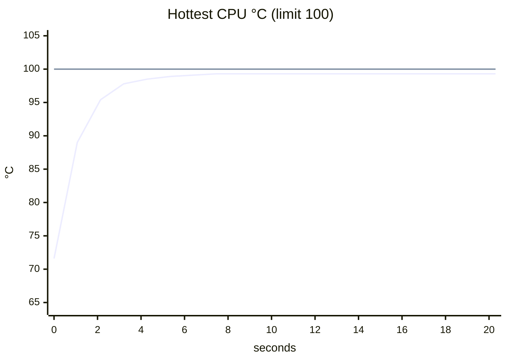

Terminals cannot draw Mermaid, so `tyr view` and the TUI show sparklines
instead. In the TUI, `R` opens the Reports dialog: host report, a stress result
or a history; Markdown or JSON; view, save or copy. Copying uses the desktop
clipboard (`wl-copy`, `xclip`, `xsel`) and OSC 52, which also reaches your
clipboard over SSH. Details: [docs/reports.md](docs/reports.md).

---

## Directory Structure

```text
tyr/
├── cmd/tyr/                 CLI: TUI, report, stress, history, view, net-peer
├── internal/
│   ├── collector/           collector interface and the modules
│   │   ├── system/          identity, BIOS, BMC, PSUs, fans
│   │   ├── cpu/             sockets, cores, temperatures, MCE, AMD limits
│   │   ├── memory/          DIMMs, EDAC, poisoned pages
│   │   ├── storage/         disks, SMART, RAID, filesystems
│   │   ├── network/         ports, bonds, counters, transceivers, LLDP
│   │   └── accel/           GPUs and NPUs
│   ├── source/              readers and parsers: sysfs, dmi, smart, ipmi, raid, pci, gpu, kernellog, netinfo
│   ├── check/               thresholds → OK / WARN / CRIT
│   ├── model/               Snapshot and the shared types (JSON schema 1.0)
│   ├── stress/              lifecycle, guard, engines, install planner, series
│   ├── workload/            self-checking compute kernels (golden values)
│   ├── report/              Markdown, Mermaid, history, glamour rendering
│   ├── tui/                 Bubble Tea TUI
│   ├── netpeer/, netproto/  network test peer and protocol
│   └── execx/, hostfs/, …   safe tool execution, read-only host access
├── testdata/fixtures/       recorded hosts (server-degraded, server-healthy, …)
├── docs/                    architecture, health checks, stress, reports, TUI
│   ├── diagrams/            archify sources (.json) and pages (.html)
│   └── images/              diagram SVGs and TUI screens
├── scripts/                 hooks, attribution check, fixture capture, diagram export
└── .github/workflows/ci.yml lint, tests, static builds
```

---

## Development

See [DEVELOPER.md](DEVELOPER.md): layout, fixtures and golden screens, the
diagrams, hooks and the release build. Turn on the hooks once per clone:

```bash
git config core.hooksPath scripts/hooks
```

---

## Further Documentation

| Document | Audience | Summary |
|---|---|---|
| [DEVELOPER.md](DEVELOPER.md) | contributors | build, test, fixtures, goldens, diagrams, hooks |
| [docs/README.md](docs/README.md) | everyone | index of the deep dives |
| [docs/architecture.md](docs/architecture.md) | engineers | packages, data flow, refresh loop |
| [docs/health-checks.md](docs/health-checks.md) | operators | modules, sources, limits, findings |
| [docs/stress-tests.md](docs/stress-tests.md) | operators | engines, guard, verdicts, network peer |
| [docs/reports.md](docs/reports.md) | operators | Markdown, Mermaid, history, clipboard |
| [docs/tui.md](docs/tui.md) | users | every tab and key |
| [docs/DESIGN.md](docs/DESIGN.md) | engineers | the original design proposal |

---

## Glossary

| Term | Meaning |
|---|---|
| **BMC / IPMI** | the server's management controller and its protocol; Tyr only runs read-only IPMI commands |
| **SEL** | the BMC's system event log |
| **ECC: CE / UE** | corrected / uncorrected memory errors; growing CE is a warning, any UE is critical |
| **EDAC** | the Linux driver framework that counts ECC errors per DIMM |
| **MCE** | machine check exception: the CPU reporting a hardware error |
| **Tjmax** | the highest temperature a CPU is specified for; it throttles itself there |
| **SMART** | a drive's self-monitoring data: reallocated and pending sectors, wear, errors |
| **PPIN** | Protected Processor Inventory Number, a unique CPU id |
| **VPD** | Vital Product Data: a PCI card's part and serial number |
| **PSI** | Linux pressure stall information; "full" memory stall means thrashing |
| **OSC 52** | the terminal escape sequence that writes to the clipboard, also over SSH |
| **Fixture** | a recorded host (sysfs/procfs files and tool output) for tests and demos |
