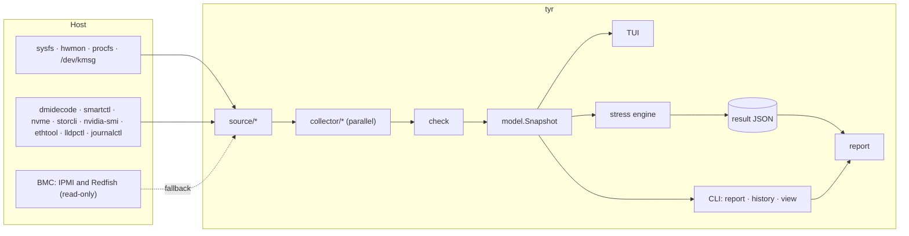
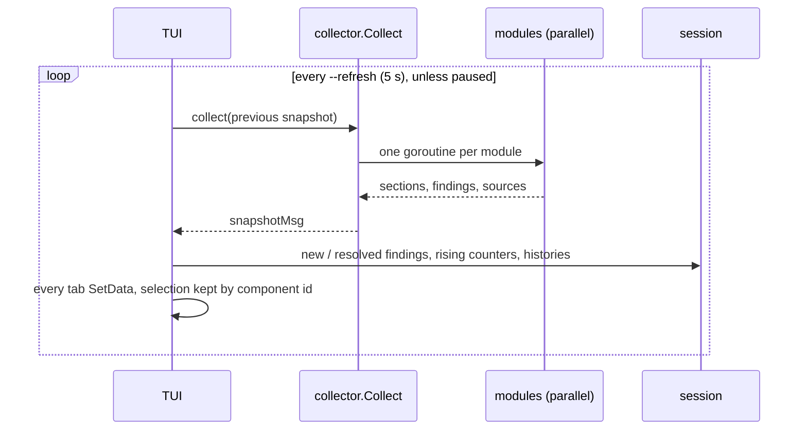

# Architecture


Tyr is one Go binary without cgo. Everything it knows about a host goes into a
single `model.Snapshot`; the TUI, the CLI, the stress engine and the reports all
read that snapshot or its JSON.

## Layers

| Layer | Packages | Job |
|---|---|---|
| Host access | `hostfs`, `execx` | read-only `/proc`, `/sys`, `/dev`; tools without a shell, with deadlines |
| Sources | `source/sysfs`, `dmi`, `smart`, `ipmi`, `redfish`, `raid`, `pci`, `gpu`, `kernellog`, `netinfo` | read and parse one kind of data |
| Collectors | `collector/system`, `cpu`, `memory`, `storage`, `power`, `network`, `accel`, `events` | combine sources into a section with findings |
| Checks | `check` | thresholds → `OK` / `WARN` / `CRIT` / `UNKNOWN` |
| Explanations | `explain` | the alert catalog: meaning, usual causes, commands per finding code |
| Model | `model` | `Snapshot`, sections, sensors, findings, inventory; JSON schema 1.0 |
| Consumers | `tui`, `cmd/tyr`, `stress`, `report` | show, export, load, report |



## Collection

`collector.Collect` starts one goroutine per module, each with a timeout
(`--timeout`, 10 s). A module returns its section: readings, the findings it
raised, and the state of every source it tried (`ok`, `unavailable` with a
reason, `not_applicable`, `skipped`). The previous snapshot is passed in, so
counters can be turned into rates and slow data (caches, flags, firmware) can
be carried over.

Some data is expensive and changes slowly, so it is read once or cached:

| Data | Read | Why |
|---|---|---|
| SMART | every `--smart-interval` (5 min), `r` and stress snapshots fresh | every rejected query counts as a SCSI error on the disk |
| Machine checks and program crashes of earlier boots, crash records (pstore), rasdaemon, boot history | once per process | they only change with a reboot |
| Receive ring and queue size of each NIC (`ethtool -g` / `-l`) | once per interface | configuration |
| Redfish event logs / power | every 2 min / 15 s, in the background | a BMC answers slowly; a collection round never waits longer than its timeout, the data arrives with the next refresh |

The Redfish client is found once per process: the BMC's host interface
(SMBIOS type 42) first, then a configured address.

## The refresh loop



While a stress test runs, the stress monitor's one-second samples feed the TUI
instead, so the other tabs stay live without a second collection.

The session keeps what a single snapshot cannot: when a finding first appeared
(`NEW`), what resolved, which counters grew and by how much, and short value
histories for the sparklines.

## The snapshot

```json
{
  "schema_version": "1.0",
  "tyr_version": "v0.9.0",
  "hostname": "srv-degraded-01",
  "timestamp": "2026-11-16T09:00:00Z",
  "privileged": true,
  "status": "CRIT",
  "summary": "1 core offline (cpu7); …",
  "system":  { "status": "OK",   "findings": [], "sources": [], "…": "…" },
  "cpu":     { "status": "CRIT", "logical": [], "package_temps": [], "…": "…" },
  "memory":  { "…": "…" },
  "storage": { "…": "…" },
  "power":   { "supplies": [], "consumed_watts": 412, "redundancy": [], "…": "…" },
  "network": { "…": "…" },
  "accel":   { "…": "…" },
  "events":  { "logs": [], "entries": [], "…": "…" },
  "inventory": [ { "category": "dimm", "location": "P2-DIMMB1", "serial": "…", "status": "CRIT" } ]
}
```

`tyr report --format json` writes it; the TUI's `e` exports it; every stress
result embeds the snapshot before and after the load. The report package reads
any of them back (see [reports.md](reports.md)).

## Design rules

- **Read-only.** Collectors never write; IPMI runs an allowlist of read-only
  commands and Redfish only GET requests; the boot configuration is never
  touched. The only writes are the storage file test's temporary file, result
  and export files, the Redfish certificate pin appended to its config file,
  and - each after a confirmation - package installs started from the Stress
  tab and the offline-core test, which brings one CPU online in an isolated
  cpuset partition and puts everything back (a state file in `/run` makes
  that recoverable after a kill).
- **Local first.** Linux interfaces before tools, tools before the BMC.
- **Nothing silent.** Unusable sources are listed with their reason.
- **Limits of the part first.** A sensor's own threshold wins; defaults fill gaps.
- **Status without colour.** Glyph and word for every status.
