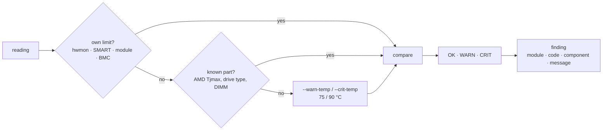

# Health checks

Every module turns readings into findings with a status. The host's status is
the worst of its modules.

| Status | Glyph | Meaning | Exit code |
|---|---|---|---|
| OK | ● | within limits | 0 |
| WARN | ▲ | degraded, or close to a limit; plan action | 1 |
| CRIT | ✖ | failed or past a limit; act now | 2 |
| UNKNOWN | ? | could not be read | 3 |
| unavailable | ○ | the source is missing, with the reason | - |
| not applicable | · | the check does not apply (no NPU, a VM without a BMC) | - |



## Limits

| Reading | Source of the limit | Default when none |
|---|---|---|
| CPU temperature (Intel) | coretemp's crit (TjMax) | 75 / 90 °C |
| CPU temperature (AMD) | k10temp has none: Tjmax per family - Ryzen 7000 / 9000 desktop 95 °C; Ryzen 7040 / 8040, Ryzen AI 300, Ryzen AI Max 100 °C; warn 10 °C below | 75 / 90 °C for other models |
| DIMM temperature | the sensor's own limits | 85 / 95 °C (JEDEC) |
| Disk temperature | SMART / NVMe thresholds | HDD 55 / 65 °C, SSD and NVMe 70 / 80 °C |
| GPU / NPU temperature | the driver's slowdown / shutdown limits | 85 / 95 °C |
| Inlet / exhaust | the BMC's thresholds | 40 / 45 °C |
| Filesystem used, inodes used | - | 85 / 95 % |
| SSD wear | - | 90 % / 100 % of rated endurance |
| Transceiver optics, voltage, bias | the module's own alarm and warning limits | - |

`--warn-temp` and `--crit-temp` set the defaults; given explicitly they also
replace the AMD table.

## Modules

### System

Vendor, product, serial, BIOS, board, chassis, BMC firmware, kernel and
uptime; the PSU inventory (SMBIOS type 39); fans and inlet/exhaust
temperatures (hwmon, else the BMC).

Findings: `fan_failed` ✖, `fan_low` ▲, temperatures past their limits.

### CPU

Sockets (model, PPIN, microcode), every logical CPU (online, clock, load,
temperature, throttle count, machine checks), package and core temperatures,
an optional per-core compute test (`--core-test`).

| Code | Status | When |
|---|---|---|
| `core_offline` | ✖ | a present CPU is offline |
| `cpu_missing` | ▲ | the kernel sees fewer CPUs than SMBIOS reports (e.g. `maxcpus=`) |
| `cpu_temp`, `core_temp` | ▲ / ✖ | past the warn / crit limit |
| `mce` | ▲ / ✖ | machine check records in the kernel log, severity from the record |
| `mce_exceptions` | ▲ | machine check exceptions counted in `/proc/interrupts` |
| `throttling` | ▲ | thermal throttling since the last refresh |
| `microcode_mismatch` | ▲ | sockets run different microcode |

### Memory

DIMMs per slot from SMBIOS (size, type, speed, rank, vendor, part, serial),
EDAC counts per DIMM, poisoned pages, memory blocks offline, DIMM temperatures,
BMC SEL memory events.

| Code | Status | When |
|---|---|---|
| `ecc_uncorrectable` | ✖ | any uncorrected error |
| `ecc_correctable` | ▲ | corrected errors |
| `hardware_corrupted` | ✖ | the kernel poisoned memory |
| `capacity_mismatch` | ▲ | installed memory ≠ memory the OS sees |
| `memory_offline` | ▲ | memory blocks offline |
| `dimm_speed_mismatch`, `mixed_part_numbers` | ▲ | DIMMs that do not match |
| `numa_imbalance` | ▲ | one node has clearly less memory |

### Storage

Disks (SATA, SAS, NVMe) with SMART, wear and spare, I/O errors from the kernel
log, md RAID (`/proc/mdstat`), MegaRAID / PERC controllers with virtual and
physical drives and the battery, filesystems. iSCSI and Fibre Channel LUNs are
listed as **network volumes**, not disks: their session or remote port, target,
portal and state, and the kernel I/O errors on the path to the storage system.
Their SMART belongs to the storage system and is not queried.

SMART is read when Tyr starts and then every 5 minutes (`--smart-interval`);
`r` in the TUI and the snapshots before and after a stress test always read it
fresh, and the storage stress test reads it every 30 s.

| Code | Status | When |
|---|---|---|
| SMART failed, `kernel_io_errors` | ✖ | the drive reports failure, I/O errors in the kernel log (with the last line) |
| `io_errors` | ▲ | SCSI command errors that are new since Tyr started and not caused by its own SMART queries |
| `remote_io_errors` | ✖ | kernel I/O errors on an iSCSI / FC volume: the path to the storage system failed |
| `iscsi_session`, `fc_port` | ✖ | the iSCSI session is not `LOGGED_IN`, the FC remote port not `Online` |
| reallocated / pending sectors, media errors | ▲ | growing defect counters |
| `wear`, `spare_low` | ▲ / ✖ | endurance used up, spare below threshold |
| `md_degraded`, `md_inactive`, `md_member_failed` | ✖ | software RAID lost redundancy |
| `md_sync` | ▲ | resync / recovery running |
| `raid_controller` | ▲ / ✖ | hardware RAID: degraded VD, failed PD, battery |
| `fs_read_only` | ✖ | a filesystem was remounted read-only |
| `fs_full` | ▲ / ✖ | 85 / 95 % space or inodes |

#### SCSI command errors (`ioerr_cnt`)

`/sys/block/sdX/device/ioerr_cnt` counts every SCSI command that ended with an
error since the driver loaded - also commands the drive or the controller
merely rejects, above all SMART and ATA pass-through queries a RAID or SAS
controller does not support. A large count that is the same on every disk
behind one controller, with nothing in the kernel log, is that, not failing
disks. Tyr therefore:

- shows the count since boot, but does not raise a finding for it,
- reads the counter before and after each of its own SMART queries and keeps
  that part apart ("173 by Tyr's SMART reads"),
- warns only about errors that are new since it started and that it did not
  cause, and uses the same corrected counter for stress test verdicts.

#### Troubleshooting storage

```bash
lsblk -S -o NAME,TRAN,VENDOR,MODEL,SIZE              # local (sas, sata, nvme) vs. iscsi / fc
journalctl -k -b | grep -E '\bsd[a-z]+\b' | grep -iE 'I/O error|medium|reset|timeout' | tail
# does a SMART query raise ioerr_cnt? (then the count is rejected commands)
d=sda; b=$(printf '%d' "$(cat /sys/block/$d/device/ioerr_cnt)"); smartctl -x /dev/$d >/dev/null
echo $(( $(printf '%d' "$(cat /sys/block/$d/device/ioerr_cnt)") - b ))
# iSCSI path
iscsiadm -m session -P 3 | grep -E 'Target:|Current Portal|Session State|Attached scsi disk'
journalctl -k -b | grep -iE 'iscsi|connection[0-9]+:' | tail
```

- **Kernel I/O errors on a local disk**: look at pending and reallocated
  sectors (the disk), CRC errors (cable, backplane, connector), and the kernel
  log around the time of the last error the finding shows.
- **CRC errors**: a few over the disk's life usually come from a hot-plug or a
  reseat; if they grow, reseat the disk, then check the slot and cable.
- **Kernel I/O errors on a network volume**: the session dropped or timed out;
  check the session state, the network to the portal and the target's logs.
- **Empty slots and disks hidden by the controller or the BMC** are not visible
  to Linux; only the controller's tool or the BMC shows them.

### Network

Ports with driver, firmware, PCI VPD serial, link speed vs. port and partner,
duplex, bonds and their members, VLANs, error counters (CRC, drops, carrier
changes), transceivers with optics, LLDP neighbours (`lldpctl`), the BMC's LAN
settings. `h` in the TUI / `--nic-all` adds virtual interfaces.

Findings include `link_down`, `bond_degraded`, a port below its own or the
partner's speed, `half_duplex`, `crc_errors`, and `transceiver` optics out of
range.

### GPU / NPU

PCI inventory and link (width and generation against the device's maximum),
driver, firmware, temperatures, power and cap, clocks, memory use, ECC,
retired / remapped rows, Xid driver errors from the kernel log. NVIDIA through
`nvidia-smi`, AMD and Intel GPUs through sysfs, AMD NPUs through `xrt-smi`.
BMC display adapters are listed but not counted.

### Power and Events

No collector yet: the TUI shows both as ○ unavailable with the reason. PSU
inventory and fans come from the System module; machine checks, I/O errors and
Xid events are already raised by the modules they belong to.

## Without root

Tyr runs, and every module lists what it skipped. Root adds: serials and DIMM
slots (dmidecode), PCI VPD, SMART on most drives, `/dev/kmsg`, IPMI, PPIN.
