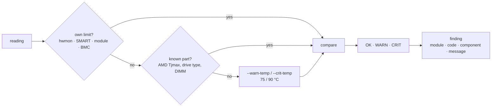

# Health checks

Every module turns readings into findings with a status. The host's status is
the worst of its modules.

| Status | Glyph | Meaning | Exit code |
|---|---|---|---|
| OK | ● | within limits | 0 |
| WARN | ▲ | degraded, or close to a limit; plan action | 1 |
| CRIT | ✖ | failed or past a limit; act now | 2 |
| UNKNOWN | ? | could not be read | 3 |
| unavailable | ○ | the source is missing, with the reason | - |
| not applicable | · | the check does not apply (no NPU, a VM without a BMC) | - |

## Limits

| Reading | Source of the limit | Default when none |
|---|---|---|
| CPU temperature (Intel) | coretemp's crit (TjMax) | 75 / 90 °C |
| CPU temperature (AMD) | k10temp has none: Tjmax per family - Ryzen 7000 / 9000 desktop 95 °C; Ryzen 7040 / 8040, Ryzen AI 300, Ryzen AI Max 100 °C; warn 10 °C below | 75 / 90 °C for other models |
| DIMM temperature | the sensor's own limits | 85 / 95 °C (JEDEC) |
| Disk temperature | SMART / NVMe thresholds | HDD 55 / 65 °C, SSD and NVMe 70 / 80 °C |
| GPU / NPU temperature | the driver's slowdown / shutdown limits | 85 / 95 °C |
| Inlet / exhaust | the BMC's thresholds | 40 / 45 °C |
| Filesystem used, inodes used | - | 85 / 95 % |
| SSD wear | - | 90 % / 100 % of rated endurance |
| Transceiver optics, voltage, bias | the module's own alarm and warning limits | - |

`--warn-temp` and `--crit-temp` set the defaults; given explicitly they also
replace the AMD table.

## Modules

### System

Vendor, product, serial, BIOS, board, chassis, BMC firmware, kernel and
uptime; the PSU inventory (SMBIOS type 39); fans and inlet/exhaust
temperatures (hwmon, else the BMC).

Findings: `fan_failed` ✖, `fan_low` ▲, temperatures past their limits.

### CPU

Sockets (model, PPIN, microcode), every logical CPU (online, clock, load,
temperature, throttle count, machine checks), package and core temperatures,
an optional per-core compute test (`--core-test`).

| Code | Status | When |
|---|---|---|
| `core_offline` | ✖ | a present CPU is offline |
| `cpu_missing` | ▲ | the kernel sees fewer CPUs than SMBIOS reports (e.g. `maxcpus=`) |
| `cpu_temp`, `core_temp` | ▲ / ✖ | past the warn / crit limit |
| `mce` | ▲ / ✖ | machine check records in the kernel log, severity from the record |
| `mce_exceptions` | ▲ | machine check exceptions counted in `/proc/interrupts` |
| `throttling` | ▲ | thermal throttling since the last refresh |
| `microcode_mismatch` | ▲ | sockets run different microcode |

### Memory

DIMMs per slot from SMBIOS (size, type, speed, rank, vendor, part, serial),
EDAC counts per DIMM, poisoned pages, memory blocks offline, DIMM temperatures,
BMC SEL memory events.

| Code | Status | When |
|---|---|---|
| `ecc_uncorrectable` | ✖ | any uncorrected error |
| `ecc_correctable` | ▲ | corrected errors |
| `hardware_corrupted` | ✖ | the kernel poisoned memory |
| `capacity_mismatch` | ▲ | installed memory ≠ memory the OS sees |
| `memory_offline` | ▲ | memory blocks offline |
| `dimm_speed_mismatch`, `mixed_part_numbers` | ▲ | DIMMs that do not match |
| `numa_imbalance` | ▲ | one node has clearly less memory |

### Storage

Disks (SATA, SAS, NVMe) with SMART, wear and spare, I/O errors from the kernel
log, md RAID (`/proc/mdstat`), MegaRAID / PERC controllers with virtual and
physical drives and the battery, filesystems.

| Code | Status | When |
|---|---|---|
| SMART failed, `kernel_io_errors` | ✖ | the drive reports failure, I/O errors in the kernel log |
| reallocated / pending sectors, media errors | ▲ | growing defect counters |
| `wear`, `spare_low` | ▲ / ✖ | endurance used up, spare below threshold |
| `md_degraded`, `md_inactive`, `md_member_failed` | ✖ | software RAID lost redundancy |
| `md_sync` | ▲ | resync / recovery running |
| `raid_controller` | ▲ / ✖ | hardware RAID: degraded VD, failed PD, battery |
| `fs_read_only` | ✖ | a filesystem was remounted read-only |
| `fs_full` | ▲ / ✖ | 85 / 95 % space or inodes |

### Network

Ports with driver, firmware, PCI VPD serial, link speed vs. port and partner,
duplex, bonds and their members, VLANs, error counters (CRC, drops, carrier
changes), transceivers with optics, LLDP neighbours (`lldpctl`), the BMC's LAN
settings. `h` in the TUI / `--nic-all` adds virtual interfaces.

Findings include `link_down`, `bond_degraded`, a port below its own or the
partner's speed, `half_duplex`, `crc_errors`, and `transceiver` optics out of
range.

### GPU / NPU

PCI inventory and link (width and generation against the device's maximum),
driver, firmware, temperatures, power and cap, clocks, memory use, ECC,
retired / remapped rows, Xid driver errors from the kernel log. NVIDIA through
`nvidia-smi`, AMD and Intel GPUs through sysfs, AMD NPUs through `xrt-smi`.
BMC display adapters are listed but not counted.

### Power and Events

No collector yet: the TUI shows both as ○ unavailable with the reason. PSU
inventory and fans come from the System module; machine checks, I/O errors and
Xid events are already raised by the modules they belong to.

## Without root

Tyr runs, and every module lists what it skipped. Root adds: serials and DIMM
slots (dmidecode), PCI VPD, SMART on most drives, `/dev/kmsg`, IPMI, PPIN.
