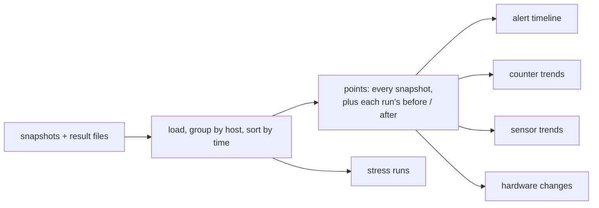
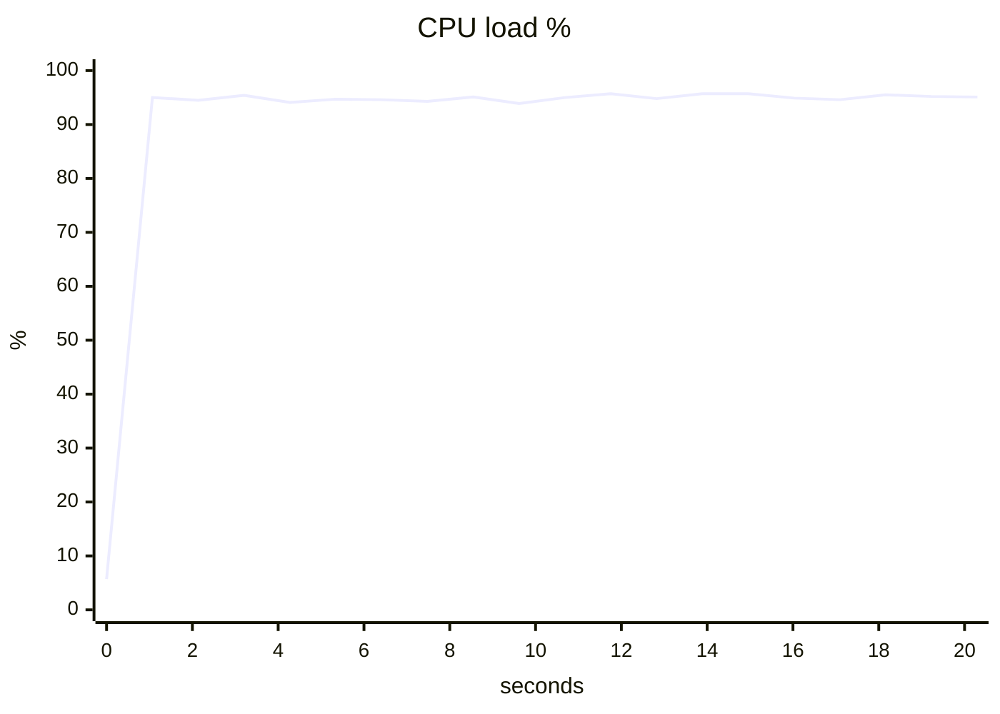
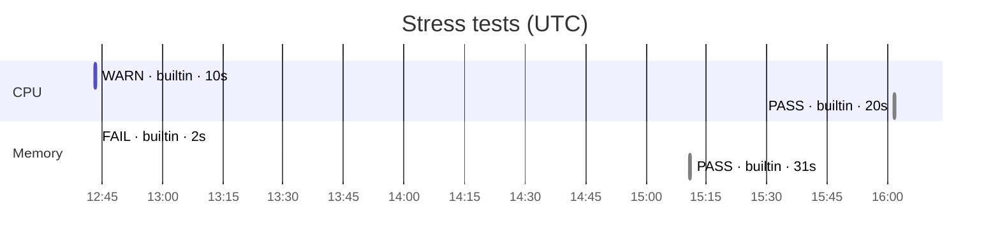

# Reports and history


Tyr writes three kinds of report, each as Markdown and JSON, from the live host
or from saved JSON:

| Report | From | Contains |
|---|---|---|
| **Host report** | a snapshot | status, alerts by severity, component health, age and power state, every logical CPU, system, CPU, memory, storage, network, GPU/NPU, the inventory with health, data sources not used |
| **Stress result** | a result file | verdict and reasons, scope, charts of the metrics over time, min / avg / max, wrong results, counters that changed, new alerts, component health after the test (and every core after a CPU test), the log |
| **History** | any number of snapshots and result files | per host: component health now, status over time, alert timeline, counter and sensor trends, hardware and firmware changes, the stress runs |

## Age and power

The host report lists, as far as the hardware reports it, how long each part
has been in service, how often it was power-cycled, when it was made, and its
power state now:

| Component | In service | Power cycles | Manufactured | State |
|---|---|---|---|---|
| system | uptime | - | board FRU date (IPMI) | running; BIOS version and date |
| disks | SMART power-on hours | SMART | - | notes: unsafe shutdowns, wear, data written |
| transceivers | - | - | SFF date code (`ethtool -m`) | link up / no link |
| GPUs, NPUs | - | - | - | PCI power state (D0, D3hot), runtime PM |
| PSUs, CPUs | - | - | - | SMBIOS state; CPUs online |

Linux does not report when CPUs and DIMMs were made (DIMM SPD data is not read)
or the power-on time of CPUs, DIMMs, PSUs and fans. The dates are also in the
JSON: `system.frus[].mfg_date`, `network.interfaces[].transceiver.date_code`.

## Commands

```bash
tyr report                                         # text, this host
tyr report --format markdown > host.md             # Markdown, this host
tyr report --format json > host.json               # the snapshot - keep these for history
tyr report --from host.json --format markdown      # a saved snapshot or stress result
tyr history ./results/ > history.md                # history of every host in the files
tyr history --format json --host db-01 ./results/  # one host, as JSON for tools
tyr view host.json                                 # one report in a pager
tyr view ./results/                                # their history in a pager
tyr view history.md                                # any Markdown file
```

`tyr history` and `tyr view` take files and directories (searched for
`*.json`). Files that are not Tyr snapshots or stress results are listed as
skipped. Tyr keeps no history on its own: collect the JSON you want - reports,
TUI exports, stress result files, also copied back from remote hosts - and
pass it in.

## History



| Section | How it is built |
|---|---|
| Status over time | one row per snapshot: status, ✖ and ▲ counts, summary |
| Alert timeline | each alert (module, code, component) with first and last seen and how often; *resolved* only when its module was collected again without it |
| Counter trends | error and event counters that changed between the first and last snapshot; a counter that went down is marked as reset (reboot or driver reload) |
| Sensor trends | min, max and last of every temperature and fan, with its limit and worst status |
| Hardware changes | parts added, removed or replaced (serial or model changed), firmware, BIOS, BMC, kernel and microcode updates |
| Stress tests | every run with verdict, duration, engine, wrong results and the hottest CPU; as a table and a Mermaid gantt |

The JSON form (`--format json`) carries the same data, one object per host.

## Charts

Stress results store each metric over time. In Markdown they become Mermaid
charts, which GitLab, GitHub, Obsidian and mermaid.live render:



The history adds the runs as a gantt, one section per test:



Terminals cannot draw Mermaid. `tyr view`, the TUI and glow get the same series
as sparklines with min, average, max and the limit:

```text
CPU load %                  ▁▇▇▇▇▇▇▇▇▇▇▇▇▇▇▇▇▇▇▇  min 5.7 · avg 90.5 · max 95.7 %
Hottest CPU °C (limit 100)  ▁▅▇▇▇▇▇█████████████  min 71.6 · avg 97.1 · max 99.3 °C · limit 100
```

`--charts text` gives the sparkline form in `tyr report --from` and
`tyr history`, for example to pipe into `glow -`.

## In the TUI

`R` opens the Reports dialog:

| Field | Choices |
|---|---|
| Report | host report, stress result (this session's runs and earlier result files), history |
| Source | the run (←→), or the files and directories for the history (prefilled with the export and run directories) |
| Format | Markdown, JSON |
| Output | view, save, copy, view + save, view + copy |

A viewed report is a page with scrolling and `/` search; `c` copies it. `e`
on any tab writes the current snapshot as JSON and Markdown.

## Copying

`c` on a report page or in `tyr view` copies the report - the Markdown with the
Mermaid charts, or the JSON - not the terminal rendering.

| Where Tyr runs | How it copies |
|---|---|
| a local desktop session | the desktop clipboard tool: `wl-copy` (Wayland), else `xclip` or `xsel`; plus OSC 52 |
| over SSH | OSC 52 only: the terminal on your machine puts the text on your clipboard |

OSC 52 works in kitty, WezTerm, foot, iTerm2, Windows Terminal and tmux (with
`set -g set-clipboard on`). GNOME Terminal and Ptyxis ignore it; locally Tyr
then relies on the clipboard tool, over SSH the footer says to save the report
instead. Some terminals cut very large OSC 52 copies (above about 100 kB).
