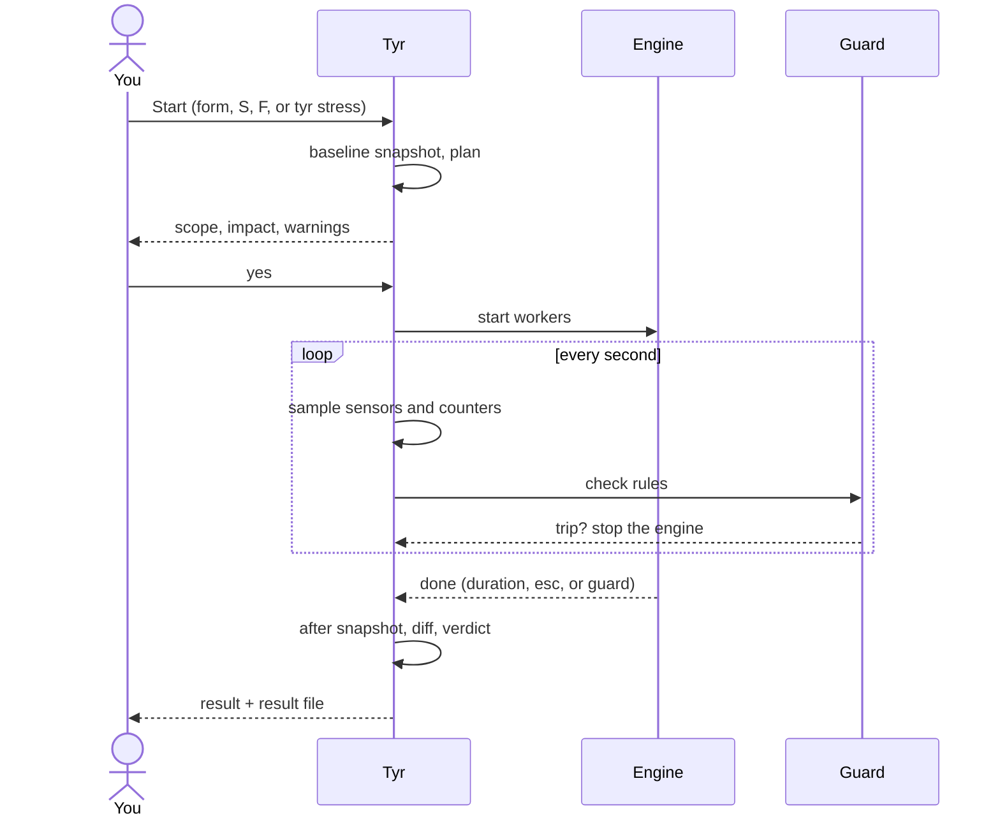
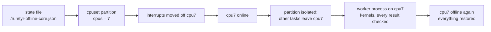

# Stress tests


A stress test loads one component - or all of them, one after another - while
Tyr watches the whole machine, then compares the machine before and after. The
point is to push the hardware to its limits and find out whether it still
computes, stores and transmits correctly there.

## Lifecycle



1. **Plan.** Tyr takes a baseline snapshot and shows what will run: scope,
   impact, warnings (offline CPUs, a hot package, swap already in use) and
   anything that blocks the run (no network peer, the host already past a
   guard point).
2. **Load.** The engine runs for the chosen duration (30 s to 24 h per
   component). Every second Tyr samples temperatures, clocks, load, rates and
   counters; the guard checks them.
3. **After.** A second snapshot; counter growth and new findings are computed
   against the baseline.
4. **Verdict.** PASS, WARN, FAIL or ABORTED, with reasons, written to a result
   file.

## Engines

| Component | Engine | What it does |
|---|---|---|
| CPU | **builtin** | integer, floating point, FMA, vector, SHA-256, CRC32C and matrix kernels on every selected CPU; every result is compared with a precomputed golden value, so a core that computes wrong under load is named |
| | `stress-ng` | `--cpu`, all methods, `--verify` |
| | `mprime` | Prime95 torture test, self-checking FFTs |
| | `offline-core` | one offline (suspect) CPU, online only for the test and isolated: see [offline cores](#offline-cores) |
| Memory | **builtin** | walking bits, random data, moving inversions, address-in-address; one thread per CPU; the buffer is locked in RAM |
| | `stress-ng` | `--vm`, all methods, `--verify` |
| | `memtester` | the memtester pattern suite |
| Storage | **builtin** | `read`: full-surface O_DIRECT read scan of a disk (never writes); `file`: write and CRC-verify a temporary file on a filesystem |
| | `stress-ng` | `--hdd` on a filesystem, `--verify` |
| Network | **builtin** | TCP streams to a `tyr net-peer`, every block CRC-checked |
| | `iperf3` | client to an `iperf3 -s` |
| | `stress-ng` | `--sock`/`--udp` on loopback: the kernel stack only, not the NIC |

External engines appear when installed. In the TUI, `i` on the Stress form
installs the packaged ones (`stress-ng`, `memtester`, `iperf3`) through the
host's package manager after a confirmation; `mprime` has no distribution
package, and `memtest86+` is never installed because its package changes the
boot loader. A pre-OS test of all RAM still needs memtest86+: Tyr detects it
and says how to boot it.

## Sizes and targets

| Component | Choice | Default |
|---|---|---|
| CPU | CPU list (`--cpus 0-7,16`, `S` on the CPU tab: the selected core and its sibling) | all online CPUs |
| Memory | percent of available memory, up to 100 (`--mem-percent`) | 70 %; a reserve of max(1 GiB, 5 % of RAM) always stays free |
| Storage | `read` a disk or all disks in parallel; `file` on a writable filesystem (`--size`) | `read`, all disks; file size min(4 GiB, 10 % of free space) |
| Network | peer, streams, direction (`--reverse`: the peer sends) | 4 streams, this host sends |

## Guard

The guard stops the load the moment one of its rules trips; the verdict is then
FAIL with the rule's reason.

| Rule | Applies to | Trips on |
|---|---|---|
| Temperature | every test | a CPU package 5 °C above its own limit (it throttles itself at the limit, which is where a stress test should take it); a drive, DIMM or GPU at its critical temperature |
| Machine check | every test | any new machine check |
| Uncorrectable ECC | every test | any new uncorrected memory error |
| SMART errors | storage | growing error counters on the disks under test |
| Memory pressure | memory | an OOM kill; available memory below half the reserve; the test's own memory in swap; thrashing (PSI full > 25 %, or > 1 GiB swapped back in without PSI) |

Swapping out idle memory of other programs is the kernel making room and does
not stop a memory test; it is noted in the log. During a memory test Tyr makes
itself the OOM killer's first choice, so a service is never the victim.

## Verdicts

| Verdict | Exit | When |
|---|---|---|
| **FAIL** | 2 | a wrong result, a guard stop, a new CRIT finding, a new machine check or uncorrectable ECC error, growing SMART or I/O error counters |
| **WARN** | 1 | growing corrected ECC errors, throttling, CRC or link errors, the CPU at its own temperature limit, network below 90 % of the link speed |
| **PASS** | 0 | none of the above |
| **ABORTED** | 3 | stopped with `esc`, or the plan was blocked (the full test lists it as SKIPPED) |

Temperature findings in the after snapshot do not count: it is taken while the
machine is still hot from the load.

## Result files

Each run writes `/var/lib/tyr/runs/<time>-<component>-<id>.json` (else
`./tyr-runs/`, or `--run-dir`). The file holds the configuration, the plan,
the verdict and reasons, min / avg / max of every metric, the metrics over
time (`series`, up to 120 points each), wrong results, counter changes, new
findings, the log, and the snapshots before and after. Reports and history read
these files back - see [reports.md](reports.md).

## Network peer

The network test needs a second host:

```bash
# on the peer
tyr net-peer                       # listens on :7300, prints a token
tyr net-peer --listen :7300 --token s3cret --idle 30m

# on the host under test
tyr stress --component network --target peer.example:7300 --token s3cret
```

In the TUI, enter the peer and token on the Stress form. Without a peer the
network test cannot run and the full test skips it.

## Offline cores

A CPU someone took offline after errors cannot be tested while it is offline.
`tyr core-test cpu7` (or `S` on the CPU in the TUI) brings it online only for
the test:



| Step | What |
|---|---|
| Isolation | a cgroup v2 cpuset partition (`isolated`, else `root`) owns the CPU, so no other task runs there; movable interrupts and the default interrupt affinity leave it. Without the cpuset controller Tyr does not bring the CPU online. |
| Test | a worker process is started inside the partition (`clone3` into the cgroup), pinned to the CPU, and runs the built-in kernels with rotating seeds; every result is compared with its golden value |
| Stops on | the first wrong result, a new machine check on that CPU (`/proc/interrupts`), the guard (temperature, any new machine check or UE), `esc` / Ctrl+C |
| Always | the CPU goes offline again, then the partition, interrupts and cpuset controller are put back |
| Confirmation | type the CPU's name (`cpu7`), not `yes` |

**Risk.** Isolation keeps other work off the CPU, but cannot stop a defective
core from raising a fatal machine check: the kernel then panics and the server
reboots. Run it in a maintenance window with workloads moved off the host. If
nothing takes the CPU offline at boot, it runs work again after such a reboot -
add a boot unit first ([health checks](health-checks.md#troubleshooting-a-suspect-core)).
Per-CPU kernel threads and managed interrupts (NVMe queues) still run on the
CPU while it is online. A pass does not prove the core healthy: faults can be
intermittent or depend on temperature and voltage. The vendor's offline
diagnostics (HPE: UEFI System Utilities / Intelligent Provisioning; Dell:
ePSA; Supermicro: the BMC's diagnostics) test outside the OS.

```bash
sudo tyr core-test cpu7 --duration 2m   # asks for "cpu7"
sudo tyr core-test --restore            # after Tyr was killed mid-test
```

If Tyr is killed during the test, the state file stays behind: the next
test refuses to start, and `tyr core-test --restore` takes the CPU offline
again and undoes the rest. A reboot also brings everything back (but the CPU
online, unless a boot unit takes it out).

## Starting a test

| Where | How |
|---|---|
| TUI, Stress tab (`9`) | the form: test, engine, duration, size; Start; type `yes` |
| TUI, any module tab | `S` stresses the selected component (a CPU and its sibling, a disk, a filesystem, memory, network); on an offline CPU, the offline-core test |
| TUI, anywhere | `F` runs the full test with defaults |
| CLI | `tyr stress --component cpu --duration 30m` (asks for `yes`; `--yes` skips the prompt) |
| CLI, offline CPU | `tyr core-test cpu7` (asks for `cpu7`) |

While a test runs the other tabs stay live; `esc` on the Stress tab aborts it
cleanly, `q` is blocked, `ctrl+c` stops the test and quits.
