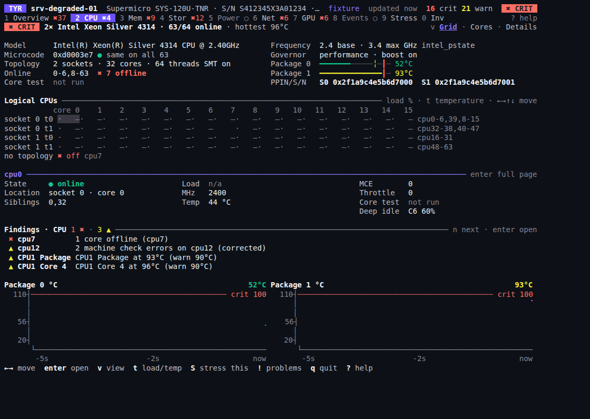
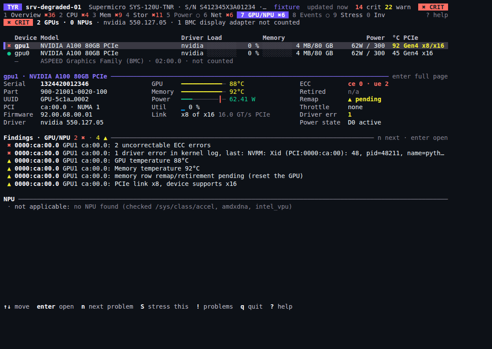
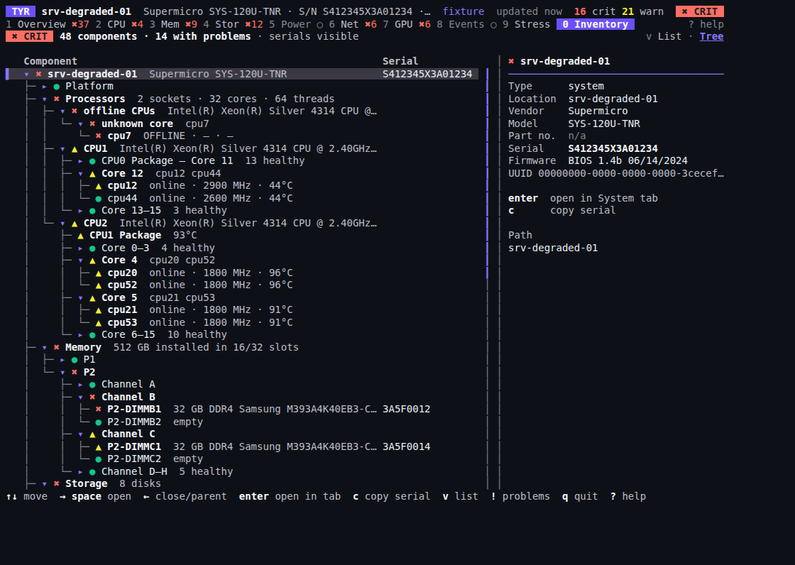
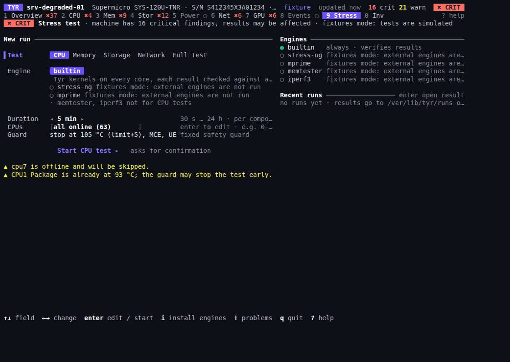
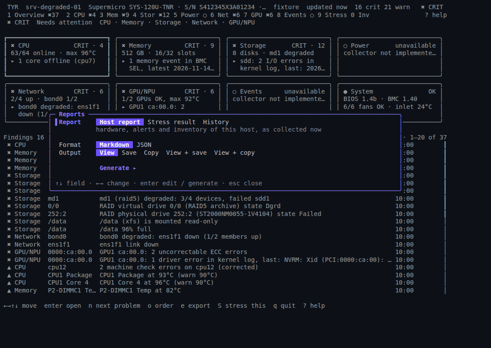
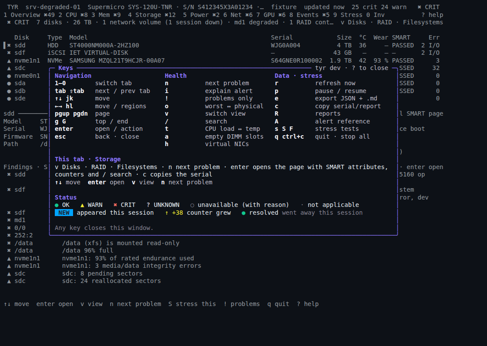

# The TUI

```bash
sudo tyr                       # this machine
tyr --fixtures testdata/fixtures/server-degraded
tyr --refresh 2s --mouse       # faster refresh, click tabs, wheel scrolls
```

Every screen has the same frame: a header (host, product, serial, uptime,
refresh state, crit/warn counts, the host status), the tab bar with each tab's
status, a status strip with the tab's key facts, the body, and a footer with
the keys that work here. `?` shows all keys and this tab's own.

## Tabs

| Key | Tab | Views (`v`) | Shows |
|---|---|---|---|
| `1` | Overview | - | a card per module, then all findings worst first; `n` or `↓` past the cards enters the findings, `enter` opens the component |
| `2` | CPU | Grid · Cores · Details | every logical CPU by socket and thread (`t`: load ↔ temperature), per-core table, socket details and graphs |
| `3` | Memory | Table · Slot map | DIMMs with an inspector; slots per socket and channel (`a`: empty slots) |
| `4` | Storage | Disks · RAID · Filesystems | disks with SMART, software and hardware RAID, filesystems |
| `5` | Power | - | PSU inventory and fans; readings ○ until a Power collector exists |
| `6` | Network | - | ports with bonds and VLANs under them, transceivers, LLDP (`h`: virtual interfaces) |
| `7` | GPU/NPU | - | load, memory, power, temperature, PCIe link; NPUs |
| `8` | Events | - | severity / source chips and search; ○ until an Events collector exists |
| `9` | Stress | form · confirm · live · result | the stress tests (see [stress-tests.md](stress-tests.md)) |
| `0` | Inventory | List · Tree | every component with serials; search, category chips; the topology tree |

`enter` on a row opens its detail page: a breadcrumb instead of the tab bar,
everything Tyr knows about the component, `/` search with `n`/`N`, `c` copies
the serial.

## Keys

| Key | Does |
|---|---|
| `1`–`0`, `tab`, `⇧tab` | switch tab |
| `↑↓` `jk`, `←→` `hl`, `pgup` `pgdn`, `g` `G` | move, page, top / end |
| `enter`, `esc` | open, back |
| `v` | next view of the tab |
| `n` | next problem |
| `!` | problems only (all tabs) |
| `o` | worst first ↔ physical order |
| `/` | search (Inventory, Events, pages) |
| `c` | copy the selected serial, or the report on a report page |
| `R` | Reports dialog |
| `A` | alert reference: every alert with meaning, causes and how to check |
| `i` | explain the selected Overview finding: where, what it means, causes, commands |
| `e` | export the snapshot as JSON and Markdown |
| `S` | stress the selected component |
| `F` | full stress test |
| `s` | Stress tab (on Events: the source filter) |
| `r`, `p` | refresh now, pause / resume |
| `?` | help |
| `q` | quit (blocked while a stress test runs) |
| `ctrl+c` | stop everything and quit |

Long entries - findings, kernel log lines, page values, stress logs - wrap
with a hanging indent instead of being cut off.

Component pages end with **About these alerts**: per kind of alert on the
component its meaning, usual causes and the commands to check it, filled in
for that component. Disk pages also show where the disk is attached
(controller, SATA/SAS port, enclosure bay) and the kernel log lines that name
it.

Tab-specific: `t` (CPU), `a` (Memory), `h` (Network), `f` `s` `space`
(Events: severity, source, details), `f` (Inventory: category), `i`
(Stress form: install engines), `→` `←` `space` (Inventory tree: open / close).

## Layout

| Width | Layout |
|---|---|
| below 80 × 24 | works down to 40 × 10, then asks for a bigger terminal |
| 80-99 | compact: details below lists, sparklines instead of graphs |
| 100-149 | standard: inspectors on the right, 2 × 2 graphs during a stress test |
| 150 and more | wide: more columns, 3 × 2 graphs |

## Themes

Tyr follows the terminal: dark or light background, true colour, 256 or 16
colours. With `NO_COLOR` or a dumb terminal it keeps the glyphs, words, bold and
reverse video, so every status stays readable - the golden tests check that
dark, light and NO_COLOR show the same text.

## Screens

| | |
|---|---|
|  |  |
|  |  |
|  |  |
|  |  |
|  |  |
|  | |
