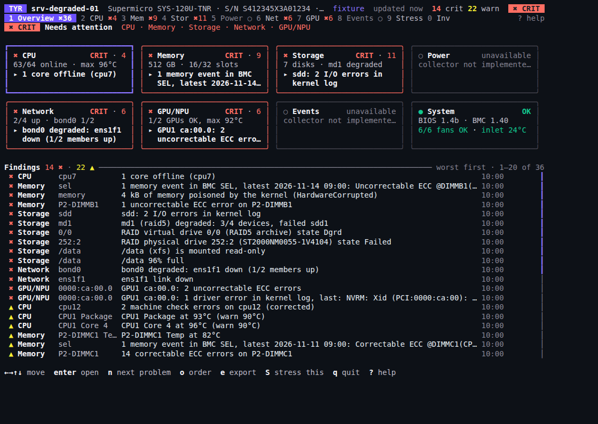
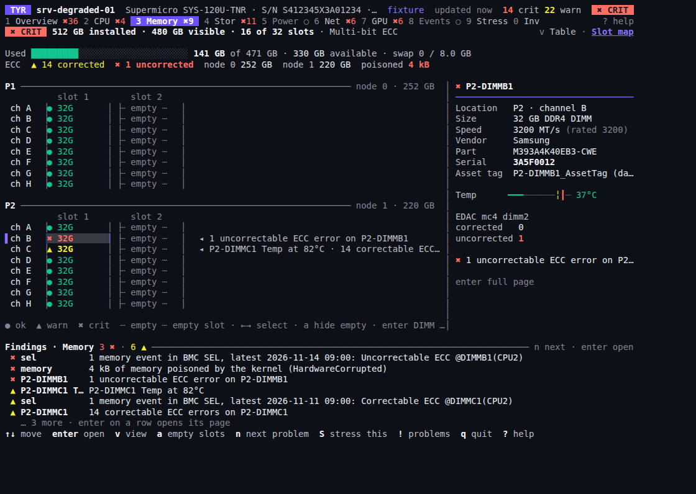
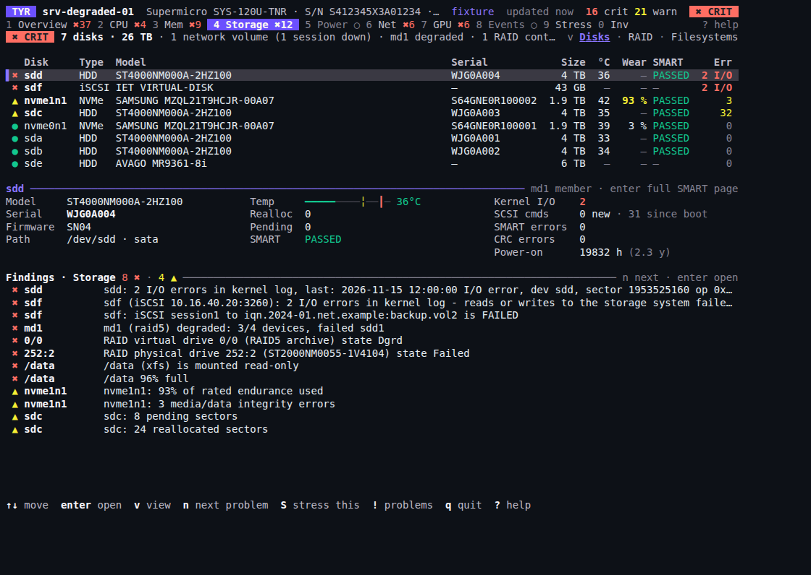
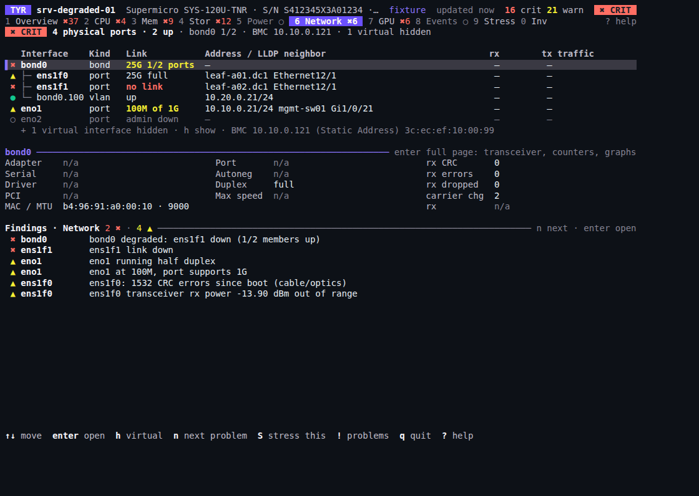
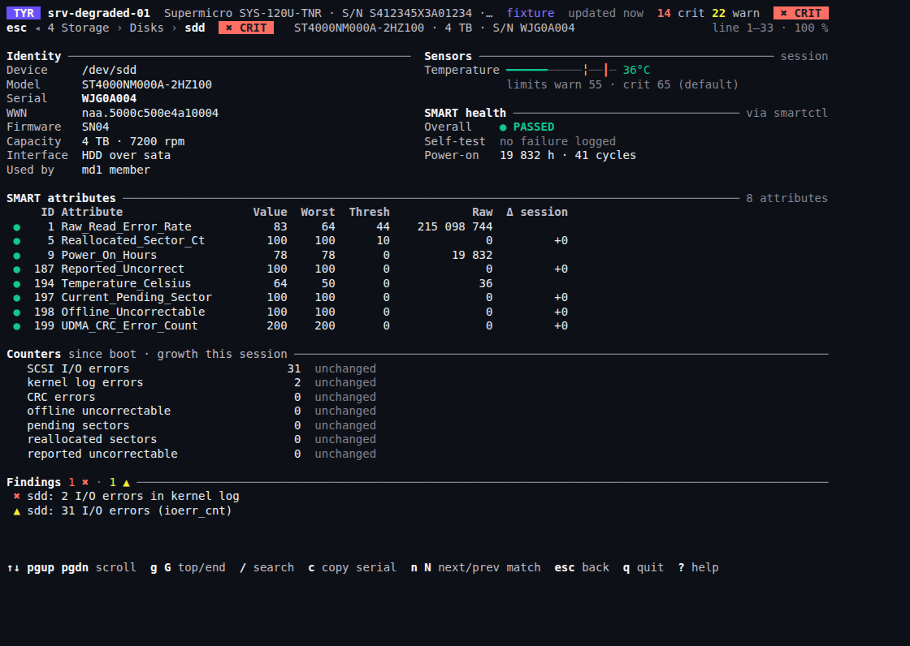
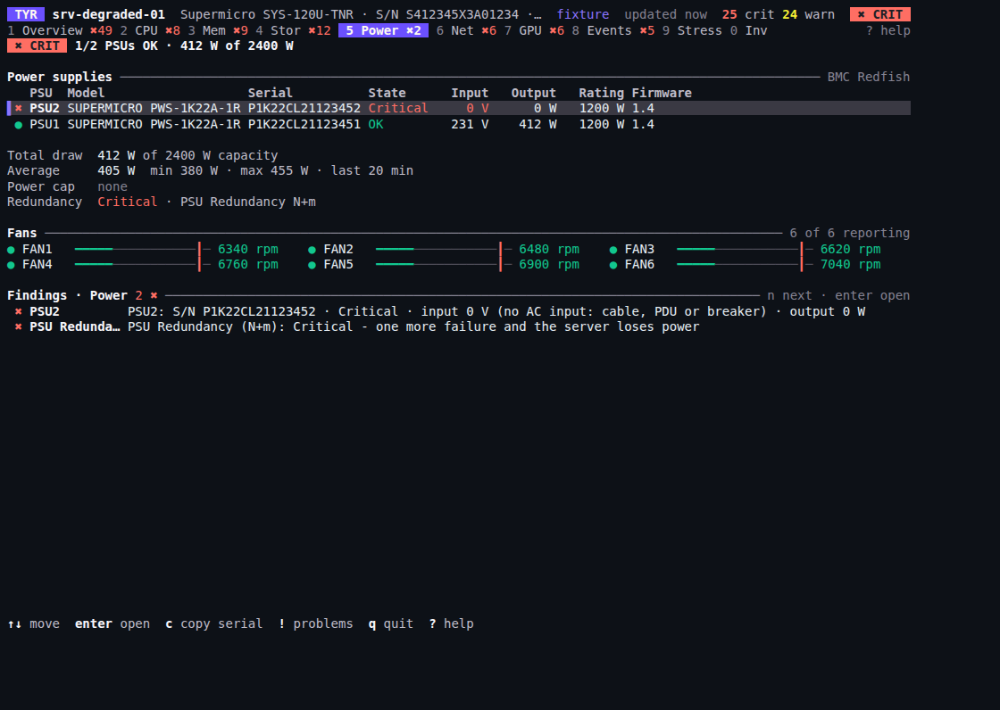
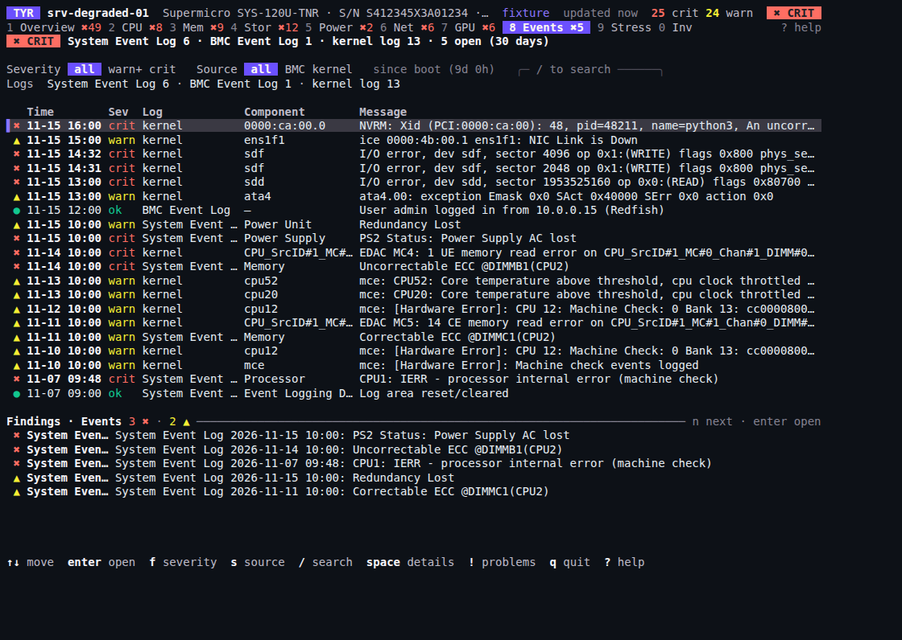
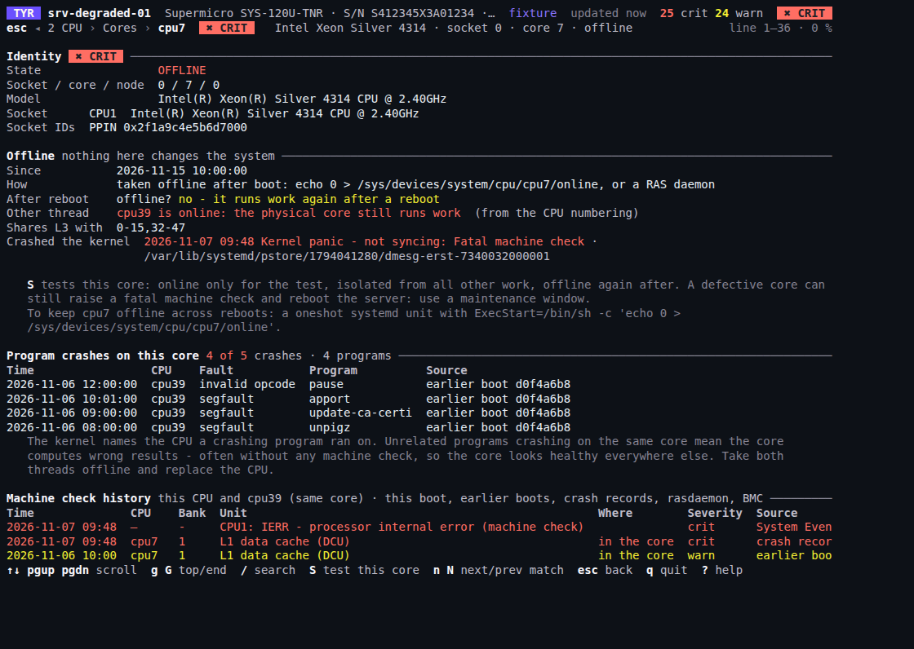
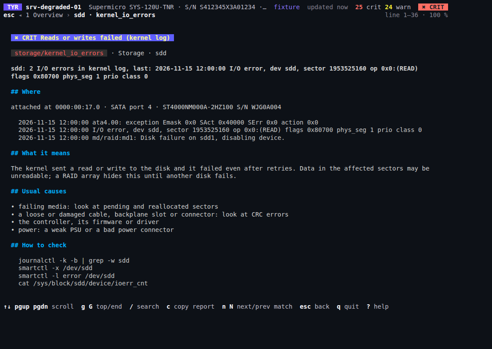

# The TUI

```bash
sudo tyr                       # this machine
tyr --fixtures testdata/fixtures/server-degraded
tyr --refresh 2s --mouse       # faster refresh, click tabs, wheel scrolls
```

Every screen has the same frame: a header (host, product, serial, uptime,
refresh state, crit/warn counts, the host status), the tab bar with each tab's
status, a status strip with the tab's key facts, the body, and a footer with
the keys that work here. `?` shows all keys and this tab's own.

## Tabs

| Key | Tab | Views (`v`) | Shows |
|---|---|---|---|
| `1` | Overview | - | a card per module (from 150 columns with a sparkline: CPU load and temperature, memory in use, network traffic, power draw, GPU load), then all findings worst first - `n` or `↓` enters them, `enter` opens the component, `i` explains the alert; on the right the counters that grew this session (with readable names), what resolved, missing data sources |
| `2` | CPU | Grid · Cores · Details | every logical CPU by socket and thread (`t`: load ↔ temperature), per-core table, socket details and graphs; an offline CPU's page shows how and since when it went offline, the other thread of its core, program crashes on that core and its machine check history |
| `3` | Memory | Table · Slot map | DIMMs with an inspector; slots per socket and channel (`a`: empty slots) |
| `4` | Storage | Disks · RAID · Filesystems | disks with SMART, software and hardware RAID (also the drives behind HPE Smart Array from the BMC: bay, endurance, power-on hours, status reasons), filesystems |
| `5` | Power | - | power supplies with state, input voltage, output and rating; total draw, average, cap, redundancy, the draw over the session; fans (BMC Redfish, else SMBIOS) |
| `6` | Network | - | ports with bonds and VLANs under them, transceivers, LLDP, VPN interfaces (WireGuard, OpenVPN, Tailscale …) with their peers (`h`: other virtual interfaces); an interface's page explains its drops and losses: where, why, ring size, commands; a VPN's page shows peers with last handshake, the service journal and kernel lines |
| `7` | GPU/NPU | - | load, memory, power, temperature, PCIe link; NPUs. GPUs on NVLink-C2C (DGX Spark's GB10, GH200) show `C2C` as their link and `shared` memory (the system's RAM); a GPU's page lists the processes holding its memory |
| `8` | Events | - | one timeline of the BMC's logs (HPE IML, iLO event log, SEL) and the kernel's hardware messages; severity / source chips, search, `space` details, `enter` the whole entry |
| `9` | Stress | form · confirm · live · result | the stress tests (see [stress-tests.md](stress-tests.md)) |
| `0` | Inventory | List · Tree | every component with serials (also the BMC's devices with part numbers); search, category chips; the topology tree, with the BMC's devices and firmware under Platform |

`enter` on a row opens its detail page: a breadcrumb instead of the tab bar,
everything Tyr knows about the component, `/` search with `n`/`N`, `c` copies
the serial.

## Keys

| Key | Does |
|---|---|
| `1`–`0`, `tab`, `⇧tab` | switch tab |
| `↑↓` `jk`, `←→` `hl`, `pgup` `pgdn`, `g` `G` | move, page, top / end |
| `enter`, `esc` | open, back |
| `v` | next view of the tab |
| `n` | next problem |
| `!` | problems only (all tabs) |
| `o` | worst first ↔ physical order |
| `/` | search (Inventory, Events, pages) |
| `c` | copy the selected serial, or the report on a report page |
| `R` | Reports dialog |
| `N` | NetBox: settings (site, role, tenant, custom fields and tags chosen from NetBox once URL and token are set), tag rules (with the facts and whether each rule matches now), test, dry run, write this machine ([netbox.md](netbox.md)) |
| `W` | Webhooks: the receivers tests notify (start, failed or warning steps, verdict); add, edit, send a test ([webhooks.md](webhooks.md)) |
| `ctrl+v` · `ctrl+c` | in a text field: paste (also the terminal's own paste) · copy the field instead of quitting |
| `A` | alert reference: every alert with meaning, causes and how to check |
| `i` | explain the selected Overview finding: where, what it means, causes, commands |
| `e` | export the snapshot as JSON and Markdown |
| `S` | stress the selected component, also from its detail page; on an offline CPU the guarded offline-core test (type the CPU's name to start) |
| `F` | full stress test |
| `s` | Stress tab (on Events: the source filter) |
| `r`, `p` | refresh now, pause / resume |
| `?` | help |
| `q` | quit (blocked while a stress test runs) |
| `ctrl+c` | stop everything and quit |

Long entries - findings, kernel log lines, page values, stress logs - wrap
with a hanging indent instead of being cut off.

Component pages end with **About these alerts**: per kind of alert on the
component its meaning, usual causes and the commands to check it, filled in
for that component. Disk pages also show where the disk is attached
(controller, SATA/SAS port, enclosure bay) and the kernel log lines that name
it; interface pages a **Drops and losses** section; offline CPU pages the
**Offline**, **Program crashes on this core** and **Machine check history**
sections.

`S` on a page starts the same test as on its row. Pages opened from the
Overview (`i`) or the alert reference (`A`) copy their Markdown with `c`.

Tab-specific: `t` (CPU), `a` (Memory), `h` (Network), `f` `s` `space`
(Events: severity, source, details), `f` (Inventory: category), `i`
(Stress form: install engines), `→` `←` `space` (Inventory tree: open / close).

## Layout

| Width | Layout |
|---|---|
| below 80 × 24 | works down to 40 × 10, then asks for a bigger terminal |
| 80-99 | compact: details below lists, sparklines instead of graphs |
| 100-149 | standard: inspectors on the right, 2 × 2 graphs during a stress test |
| 150 and more | wide: more columns, 3 × 2 graphs |

The tab bar shows each tab as a chip when they fit with their full names,
the active one in the accent colour; narrower, plain full names, then short
names (Mem, Stor, Net), then digits with the status and count. Tables
underline their header across the table and lay every other row on a faint
background (true colour and 256 colours; 16 colours and NO_COLOR keep them
plain).

## Themes

Tyr follows the terminal: dark or light background, true colour, 256 or 16
colours. With `NO_COLOR` or a dumb terminal it keeps the glyphs, words, bold and
reverse video, so every status stays readable - the golden tests check that
dark, light and NO_COLOR show the same text.

## Screens

| | |
|---|---|
|  |  |
|  |  |
|  |  |
|  |  |
|  |  |
|  |  |
|  |  |
|  | |
